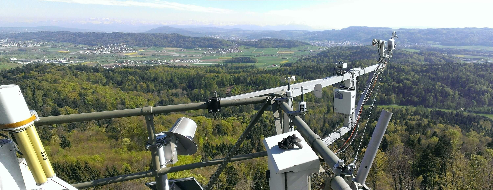
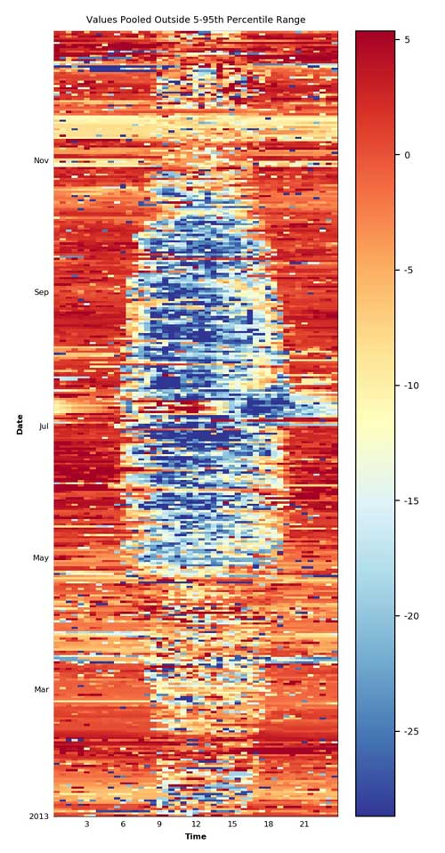

# Yearly Notes

This page documents the eddy covariance setup periods and the flux versions calculated for each
year, including the software versions used and notes on specific periods.

- The fluxes of FP2026.1 (2016 to September 2026) come from a Level-1 re-run of the whole `IRGA72`
  record in September and October 2026, one EddyPro run per setup period. Release details are in
  [Dataset versions](Dataset_Versions.md). The per-year sections below record the earlier flux
  versions.
- The numbered notes in the setup table, `(1)` to `(24)`, are defined in the
  [setup table on the Swiss FluxNet site page](https://www.swissfluxnet.ethz.ch/index.php/sites/site-info-ch-lae/ec-raw-binary-format-ch-lae/).
  They describe corrections, unusable periods and time-lag settings; read a setup period together
  with its notes.
- The flux levels are defined in the
  [Swiss FluxNet Flux Processing Chain](https://www.swissfluxnet.ethz.ch/index.php/data/ecosystem-fluxes/flux-processing-chain/).
- Periods are given as the names of the raw eddy covariance files, e.g. `2013070615.b02`. The
  name gives the start time of the file; a file typically holds 6 hours of 20 Hz data.

## Sonic anemometer

- **Model** (from the GIN fieldbook): a Gill HS-100 (serial 000027) until 19 December 2019, then
  a Gill HS-50 (serial 000063). The electronics unit of the HS-100 stayed in use until
  10 January 2020. The fieldbook has no sonic record before 2016, so the `HS50-B` in the earlier
  rows of the setup table is not confirmed by it. Where the fieldbook and the table disagree, the
  fieldbook is correct.
- **Height and orientation**: 47 m and 209°, unchanged across all years. Histograms of wind
  direction for 2004 to 2019 give very similar results across years with an orientation of 209°
  from north. One of the oldest setup files (`locations.table`) gives orientations between 183°
  and 209° and is not used. Note 5 records a possible change to 206° from `2005_2`; this has not
  been resolved.

::: {.callout-tip title="Notebooks: wind direction checks"}

- [14_IRGA75-L0_check_winddir](notebooks/00_L0_CHECKS/IRGA75/14_IRGA75-L0_check_winddir.html)
- [04_IRGA72-L0_check_winddir_2016-2026.09](notebooks/00_L0_CHECKS/IRGA72/04_IRGA72-L0_check_winddir_2016-2026.09.html)

:::

## Abbreviations

- `EC`: eddy covariance
- `FF-`: final fluxes
- `IRGA`: infrared gas analyser, used for the fluxes of CO~2~ and H~2~O (`LE`, latent heat;
  `ET`, evapotranspiration)
- `SA`: sonic anemometer, used for the sensible heat flux `H`
- `IRGA75`: open-path LI-7500; `IRGA72`: enclosed-path LI-7200

## Earlier datasets

- `Level-3-4_FLUXNET-WW2020_RELEASE-2022-1_FN-20220209`: [ICOS/FLUXNET Warm Winter 2020 ecosystem eddy covariance flux product](https://doi.org/10.18160/2G60-ZHAK)
- `Level-3-4_FLUXNET2015-FN-20190606-beta-3`: [FLUXNET Drought-2018 ecosystem eddy covariance flux product](https://doi.org/10.18160/YVR0-4898)
- `Level-3-4_FLUXNET2015-FN-20161021`: [FLUXNET2015 Dataset](https://fluxnet.org/data/fluxnet2015-dataset/), described in [Pastorello et al. (2020)](https://doi.org/10.1038/s41597-020-0534-3)
- `Level-3-4_FLUXNET-CH4-2020_V1_2012-2016`: [FLUXNET-CH4 Community Product](https://fluxnet.org/data/fluxnet-ch4-community-product/)
- [CH-LAE FP2021 (2004-2020): PI dataset](https://www.swissfluxnet.ethz.ch/index.php/documentation/ch-lae-fp2021-2004-2020/)
- [CH-LAE FP2022 (2004-2022)](https://doi.org/10.3929/ethz-b-000582198)

## Setup EC

| Year   | Binaries From  | Binaries To    | BICO | SA     | GA1          | GA2          | FR      | SA ORI     | GA1 SEP                   | GA2 SEP                   | NOTES        |
| ------ | -------------- | -------------- | ---- | ------ | ------------ | ------------ | ------- | ---------- | ------------------------- | ------------------------- | ------------ |
| 2004_1 | 2004033014.b16 | 2004123123.b00 | A    | HS50-B | IRGA75-A     | \-           | A       | 47m / 209° | N+33 E0 V-5               | \-                        |              |
| 2005_1 | 2004123123.b00 | 2005093010.b48 | A    | HS50-B | IRGA75-A     | \-           | A       | 47m / 209° | N+33 E0 V-5               | \-                        |              |
| 2005_2 | 2005093011.b57 | 2005101111.b00 | F    | HS50-B | IRGA75-A     | QCL-L2       | B / -   | 47m / 209° |                           | (1)(2)                    |              |
| 2005_3 | 2005101111.b38 | 2005111211.b00 | G    | HS50-B | IRGA75-A     | QCL-L        | C / -   | 47m / 209° |                           | (1)(3)                    |              |
| 2005_4 | 2005111215.b55 | 2005123023.b00 | A    | HS50-B | IRGA75-A     | \-           | A       | 47m / 209° | N+33 E0 V-5               | \-                        |              |
| 2006_1 | 2006010308.b00 | 2006123123.b00 | A    | HS50-B | IRGA75-A     | \-           | A       | 47m / 209° | N+33 E0 V-5               | \-                        |              |
| 2007_1 | 2006123123.b00 | 2007123123.b00 | A    | HS50-B | IRGA75-A     | \-           | A       | 47m / 209° | N+33 E0 V-5               | \-                        |              |
| 2008_1 | 2007123123.b00 | 2008051611.b00 | A    | HS50-B | IRGA75-A     | \-           | A       | 47m / 209° | \-                        |                           |              |
| 2008_2 | 2008051617.b52 | 2008061711.b00 | H    | HS50-B | IRGA75-A     | QCL-ISO      | D / -   | 47m / 209° |                           | (4)(5)                    |              |
| 2008_3 | 2008061716.b20 | 2008063011.b00 | H    | HS50-B | IRGA75-A     | (QCL-ISO)    | D / -   | 47m / 209° |                           | \-6                       |              |
| 2008_4 | 2008063012.b58 | 2008123123.b00 | A    | HS50-B | IRGA75-A     | \-           | A       | 47m / 209° | \-                        |                           |              |
| 2009_1 | 2008123123.b00 | 2009123123.b00 | A    | HS50-B | IRGA75-A     | \-           | A       | 47m / 209° | \-                        |                           |              |
| 2010_1 | 2009123123.b00 | 2010123123.b00 | A    | HS50-B | IRGA75-A     | \-           | A       | 47m / 209° | \-                        |                           |              |
| 2011_1 | 2010123123.b00 | 2011123120.b00 | A    | HS50-B | IRGA75-A     | \-           | A       | 47m / 209° | \-                        |                           |              |
| 2012_1 | 2011123120.b00 | 2012123120.b00 | A    | HS50-B | IRGA75-A     | \-           | A       | 47m / 209° | \-                        |                           |              |
| 2013_1 | 2012123120.b00 | 2013123120.b00 | A    | HS50-B | IRGA75-A     | \-           | A       | 47m / 209° | \-                        | \-8                       |              |
| 2014_1 | 2013123120.b00 | 2014123120.b00 | A    | HS50-B | IRGA75-A     | \-           | A       | 47m / 209° | \-                        |                           |              |
| 2015_1 | 2014123120.b00 | 2015123119.b00 | A    | HS50-B | IRGA75-A     | \-           | A       | 47m / 209° | N+33 E0 V-5               | \-                        |              |
| 2016_1 | 2015123119.b00 | 2016011113.b00 | A    | HS100  | IRGA75-A     | \-           | A       | 47m / 209° | N+33 E0 V-5               | \-                        |              |
| 2016_2 | 2016011115.b05 | 2016052601.b00 | C    | HS100  | IRGA75-A     | IRGA72-B     | E1 / E2 | 47m / 209° | N+33 E0 V-5               | N+6 E-1 V-15 TL100 TD0.53 | \-20         |
| 2016_3 | 2016052607.b00 | 2016123119.b00 | C    | HS100  | IRGA75-A     | IRGA72-B     | E1 / E2 | 47m / 209° | N+33 E0 V-5               | N+6 E-1 V-15 TL100 TD0.53 | \-21         |
| 2017_1 | 2016123119.b00 | 2017121207.L00 | C    | HS100  | IRGA75-A     | IRGA72-B     | E1 / E2 | 47m / 209° | N+33 E0 V-5               | N+6 E-1 V-15 TL100 TD0.53 | \-9          |
| 2017_2 | 2017121417.L22 | 2017123119.L00 | D    | HS100  | (IRGA75-A)   | IRGA72-B-GN1 | \- / E2 | 47m / 209° | \-                        | N+6 E-1 V-15 TL100 TD0.53 | (10)(15)     |
| 2018_1 | 2017123119.L00 | 2018013107.L00 | D    | HS100  | (IRGA75-A)   | IRGA72-B-GN1 | \- / E2 | 47m / 209° | \-                        | N+6 E-1 V-15 TL100 TD0.53 | (10)(15)     |
| 2018_2 | 2018013111.L28 | 2018051819.L00 | E    | HS100  | IRGA72-B-GN1 | \-           | F       | 47m / 209° | N+6 E-1 V-15 TL100 TD0.53 | \-                        | (11)(15)(19) |
| 2018_3 | 2018051901.L00 | 2018060707.L00 | E    | HS100  | IRGA72-B-GN1 | \-           | F       | 47m / 209° | N+6 E-1 V-15 TL100 TD0.53 | \-                        | (15)(19)     |
| 2018_4 | 2018060713.L00 | 2018123119.L00 | E    | HS100  | IRGA72-B-GN1 | \-           | F       | 47m / 209° | N+6 E-1 V-15 TL100 TD0.53 | \-                        | \-15         |
| 2019_1 | 2018123119.L00 | 2019011013.L00 | E    | HS100  | IRGA72-B-GN1 | \-           | F       | 47m / 209° | N+6 E-1 V-15 TL100 TD0.53 | \-                        | \-15         |
| 2019_2 | 2019011015.L54 | 2019011707.L00 | E    | HS100  | IRGA72-B-GN1 | \-           | F2      | 47m / 209° | N+6 E-1 V-15 TL100 TD0.53 | \-                        | (15)(13)(17) |
| 2019_3 | 2019011713.L22 | 2019032007.L00 | A    | HS100  | IRGA75-A     | \-           | A       | 47m / 209° | N+33 E0 V-5               | \-                        | (16)(24)     |
| 2019_4 | 2019032019.L00 | 2019123119.L00 | B    | HS100, HS50 | IRGA72-A     | \-           | G       | 47m / 209° | N+6 E-1 V-15 TL100 TD0.53 | \-                        | (14)(18)     |
| 2020_1 | 2019123119.L00 | 2020123119.L00 | B    | HS50   | IRGA72-A     | \-           | G       | 47m / 209° | N+6 E-1 V-15 TL100 TD0.53 | \-                        |              |
| 2021_1 | 2020123119.L00 | 2021121313.L00 | B    | HS50   | IRGA72-A     | \-           | G       | 47m / 209° | N+6 E-1 V-15 TL100 TD0.53 | \-                        |              |
| 2021_2 | 2021121415.L51 | 2021123119.L00 | ?    | HS50   | IRGA72-A     | \-           | G       | 47m / 209° | N+6 E-1 V-15 TL100 TD0.53 | \-                        | \-22         |
| 2022_1 | 2021123119.L00 | 2022020215.L26 | ?    | HS50   | IRGA72-A     | \-           | G       | 47m / 209° | N+6 E-1 V-15 TL100 TD0.53 | \-                        | \-22         |
| 2022_2 | 2022020710.L59 | 2022030910.L26 | B    | HS50   | IRGA72-A     | \-           | G4      | 47m / 209° | N+6 E-1 V-15 TL100 TD0.53 | \-                        | \-12         |
| 2022_3 | 2022030911.L07 | 2022111719.L00 | B    | HS50   | IRGA72-A     | \-           | G       | 47m / 209° | N+6 E-1 V-15 TL100 TD0.53 | \-                        | \-7          |
| 2022_4 | 2022111801.L00 | 2022123119.L00 | B    | HS50   | IRGA72-A     | \-           | G3      | 47m / 209° | N+6 E-1 V-15 TL100 TD0.53 | \-                        | \-7          |
| 2023_1 | 2022123113.L00 | 2023031313.L00 | B    | HS50   | IRGA72-A     | \-           | G       | 47m / 209° | N+6 E-1 V-15 TL100 TD0.53 | \-                        |              |
| 2023_2 | 2023031319.L00 | 2023123119.L00 | B    | HS50   | IRGA72-A     | \-           | G2      | 47m / 209° | N+11 E+1 V-1 TL100 TD0.53 | \-                        | \-23         |
| 2024_1 | 2023123119.L00 | 2024123119.L00 | B    | HS50   | IRGA72-A     | \-           | G2      | 47m / 209° | N+11 E+1 V-1 TL100 TD0.53 | \-                        |              |
| 2025_1 | 2024123119.L00 | 2025123119.L00 | tbc  | HS50   | IRGA72-A     | \-           | G2      | 47m / 209° | N+11 E+1 V-1 TL100 TD0.53 | \-                        | (a)          |
| 2026_1 | 2025123119.L00 | 2026093019.L00 | tbc  | HS50   | IRGA72-A tbc | \-           | tbc     | 47m / 209° | N+11 E+1 V-1 TL100 TD0.53 | \-                        | (a)          |

: EC setup periods. `tbc`: to be checked. {#tbl-setup-ec}

Notes on the table:

- The raw-file ranges of `2025_1` and `2026_1`, and their sonic model, height, orientation and
  analyser separation, are taken from the Level-1 EddyPro output (file names of the first and last
  raw files processed, and the instrument metadata of each run). `2026_1` is processed up to the
  raw file that starts on 30 September 2026 at 19:00. The `BICO` and `FR` configuration letters
  have no published legend and are still to be checked for these two periods.
- The end of `2022_4` was previously given as `2023123119.L00`. The Level-1 run of `2022_4` ends
  with the raw file that starts on 31 December 2022 at 19:00, so the table now reads
  `2022123119.L00`.
- **(a)** The fieldbook records a freshly calibrated LI-7200RS head (72H0577) with analyser unit
  AIU2485 installed at 47 m on **2 December 2025**, within `2025_1`. Whether this is a setup
  boundary is still to be checked; the Level-1 run of `2025_1` covers the whole year as one run.

***
## 2025

### Level-1 fluxes for FLUXNET

The fields below come partly from an unedited template and are still to be checked; the
instruments and the setup link are corrected. The fluxes of this year in FP2026.1 come from the
2026 Level-1 re-run.

- **Setup**: [EC raw binary format for CH-LAE](https://www.swissfluxnet.ethz.ch/index.php/sites/site-info-ch-lae/ec-raw-binary-format-ch-lae/)
- **Instruments**: HS50, IRGA72
- **Scripts**: [bico](https://github.com/holukas/bico) v1.6.5, [fluxrun](https://github.com/holukas/fluxrun) v1.4.1 ([EddyPro](https://www.licor.com/env/products/eddy-covariance/eddypro) v7.0.9)
- **FLUXNET upload**: 20 Apr 2025
- **Notes**:
	- calculated without angle-of-attack correction

***
## 2024

### Level-1 fluxes for FLUXNET

The fields below come partly from an unedited template and are still to be checked; the
instruments and the setup link are corrected. The fluxes of this year in FP2026.1 come from the
2026 Level-1 re-run.

- **Setup**: [EC raw binary format for CH-LAE](https://www.swissfluxnet.ethz.ch/index.php/sites/site-info-ch-lae/ec-raw-binary-format-ch-lae/)
- **Instruments**: HS50, IRGA72
- **Scripts**: [bico](https://github.com/holukas/bico) v1.6.5, [fluxrun](https://github.com/holukas/fluxrun) v1.4.1 ([EddyPro](https://www.licor.com/env/products/eddy-covariance/eddypro) v7.0.9)
- **FLUXNET upload**: 20 Apr 2025
- **Notes**:
	- calculated without angle-of-attack correction

***
## 2023

### Level-1 fluxes for FLUXNET

The fields below come partly from an unedited template and are still to be checked; the
instruments and the setup link are corrected. The fluxes of this year in FP2026.1 come from the
2026 Level-1 re-run.

- **Setup**: [EC raw binary format for CH-LAE](https://www.swissfluxnet.ethz.ch/index.php/sites/site-info-ch-lae/ec-raw-binary-format-ch-lae/)
- **Instruments**: HS50, IRGA72
- **Scripts**: [bico](https://github.com/holukas/bico) v1.6.5, [fluxrun](https://github.com/holukas/fluxrun) v1.4.1 ([EddyPro](https://www.licor.com/env/products/eddy-covariance/eddypro) v7.0.9)
- **FLUXNET upload**: 20 Apr 2025
- **Notes**:
	- calculated without angle-of-attack correction

### Deprecated versions
- **FF-202407**: Final Flux Version: HS50_IRGA72_FF-202407

***
## 2022

### Level-1 fluxes for FLUXNET

The fields below come partly from an unedited template and are still to be checked; the
instruments and the setup link are corrected. The fluxes of this year in FP2026.1 come from the
2026 Level-1 re-run.

- **Setup**: [EC raw binary format for CH-LAE](https://www.swissfluxnet.ethz.ch/index.php/sites/site-info-ch-lae/ec-raw-binary-format-ch-lae/)
- **Instruments**: HS50, IRGA72
- **Scripts**: [bico](https://github.com/holukas/bico) v1.6.5, [fluxrun](https://github.com/holukas/fluxrun) v1.4.1 ([EddyPro](https://www.licor.com/env/products/eddy-covariance/eddypro) v7.0.9)
- **FLUXNET upload**: 20 Apr 2025
- **Notes**:
	- calculated without angle-of-attack correction

### Deprecated versions
- **FF-202306**: Final Flux Version: HS50_IRGA72_FF-202306

***
## 2021

### Level-1 fluxes for FLUXNET

The fields below come partly from an unedited template and are still to be checked; the
instruments and the setup link are corrected. The fluxes of this year in FP2026.1 come from the
2026 Level-1 re-run.

- **Setup**: [EC raw binary format for CH-LAE](https://www.swissfluxnet.ethz.ch/index.php/sites/site-info-ch-lae/ec-raw-binary-format-ch-lae/)
- **Instruments**: HS50, IRGA72
- **Scripts**: [bico](https://github.com/holukas/bico) v1.6.5, [fluxrun](https://github.com/holukas/fluxrun) v1.4.1 ([EddyPro](https://www.licor.com/env/products/eddy-covariance/eddypro) v7.0.9)
- **FLUXNET upload**: 20 Apr 2025
- **Notes**:
	- calculated without angle-of-attack correction

***
## 2020

### Deprecated versions
- **FF-202101**: Final Flux Version: HS50-IRGA72_FF-202101 | Level-1 ID: Level-1_FR-20210419-120722 | Level-4 ID(s): [CH-LAE FP2021 (2004-2020)](https://www.swissfluxnet.ethz.ch/index.php/documentation/ch-lae-fp2021-2004-2020/) (PI dataset), [Level-3-4_FLUXNET-WW2020_RELEASE-2022-1_FN-20220209](https://www.icos-cp.eu/data-products/2G60-ZHAK) | Setup: [Setup since 2004](https://www.swissfluxnet.ethz.ch/index.php/sites/ch-lae-laegeren/data-ch-lae/ec-raw-binary-format-ch-lae/) | Instruments: HS50, IRGA72 | Scripts: [EddyPro](https://www.licor.com/env/products/eddy_covariance/eddypro) 7.0.6 (Level-1), [BICO](https://gitlab.ethz.ch/holukas/bico) v0.5.0, [FLUXRUN](https://gitlab.ethz.ch/holukas/fluxrun) v0.5.0, [diive](https://github.com/holukas/diive) v0.17.0, [ReddyProc](https://cran.r-project.org/web/packages/REddyProc/index.html) 1.2 (post-processing PI dataset) | FLUXNET upload: 09 Jun 2021 (Level-1) | Notes: Fluxes have been updated during the creation of the PI dataset [CH-LAE FP2021 (2004-2020)](https://www.swissfluxnet.ethz.ch/index.php/documentation/ch-lae-fp2021-2004-2020/). Fluxes from the open-path LI-7500 (IRGA75) have been corrected for self-heating. Info about the PI dataset: [CH-LAE FP2021 (2004-2020)](https://www.swissfluxnet.ethz.ch/index.php/documentation/ch-lae-fp2021-2004-2020/) Info about the different flux levels: [Flux Processing Chain](https://www.swissfluxnet.ethz.ch/index.php/data/ecosystem-fluxes/flux-processing-chain/)
- **FF-202008**: Final Flux Version: FF-202008 | Level-1 ID: Level-1_ID2020-08-12T001439 | Level-4 ID(s): Level-3-4_FLUXNET2015-WW2020-FN-20201217_beta-3_2004-2020.06 | Setup: [Setup since 2004](https://www.swissfluxnet.ethz.ch/index.php/sites/ch-lae-laegeren/data-ch-lae/ec-raw-binary-format-ch-lae/) | Time Period(s): 2020 (until incl. 30 Jun 2020) | Instruments: HS50, IRGA72 | Scripts: [FCT 0.9.6](https://gitlab.ethz.ch/holukas/fct-flux-calculation-tool/-/releases/v0.9.6),  [EddyPro](https://www.licor.com/env/products/eddy_covariance/eddypro) 7.0.6, [diive](https://github.com/holukas/diive) v0.16.0 | FLUXNET upload: 13 Aug 2020 (Level-1) | Notes: Fluxes were re-calculated and now include all fluxes until 30 Jun 2020, needed for ICOS Winter 2020 Initiative; For more info see here: [CH-MULTI / FF-202008](https://www.swissfluxnet.ethz.ch/index.php/documentation/ch-multi-ff-202008/).
- **FF-202006**: Final Flux Version: FF-202006 | Level-1 ID: Level-1_ID2020-06-15T110137 | Level-1.1 ID: - (no self-heating correction applied) | Level-4 ID(s): Level-3-4_FLUXNET2015-WW2020-FN-20201217_beta-3_2004-2020.06 | Setup: [Setup since 2004](https://www.swissfluxnet.ethz.ch/index.php/sites/ch-lae-laegeren/data-ch-lae/ec-raw-binary-format-ch-lae/) | Time Period(s): 2020 (until incl. 31 May 2020) | Instruments: HS50, IRGA72 | Scripts: [FCT 0.9.6](https://gitlab.ethz.ch/holukas/fct-flux-calculation-tool/-/releases/v0.9.6) with [EddyPro](https://www.licor.com/env/products/eddy_covariance/eddypro) v7.0.6 (Level-1), [FQC 2.1.2](https://gitlab.ethz.ch/holukas/fqc-flux-quality-control/-/releases/v2.1.2) (Level-2) | FLUXNET upload: not uploaded (originally thought to be for ICOS Winter 2020 Initiative) | Notes: Level-1 fluxes up until incl. 31 May 2020, but screened meteo data available until incl. 27 May 2020 13:30, therefore Level-2 fluxes were only considered until this date; Fluxes were intended for the ICOS Winter 2020 dataset, but were ultimately not used. Instead, FF-202008 (see above) with a longer time period was uploaded; For more info, see CH-LAE / FF-202006

***
## 2019

### Deprecated versions
- **FF-202101**: Final Flux Version: HS50-IRGA72-IRGA75_FF-202101 | Level-1 ID: Level-1_DIIVE-20210607-093449 (merged results from Level-1 IRGA72 fluxes and Level-1.1 IRGA75 fluxes) | Level-1.1: (only IRGA75) [CH-LAE FP2021 (2004-2020)](https://www.swissfluxnet.ethz.ch/index.php/documentation/ch-lae-fp2021-2004-2020/) | Level-4 ID(s): [CH-LAE FP2021 (2004-2020)](https://www.swissfluxnet.ethz.ch/index.php/documentation/ch-lae-fp2021-2004-2020/) (PI dataset), [Level-3-4_FLUXNET-WW2020_RELEASE-2022-1_FN-20220209](https://www.icos-cp.eu/data-products/2G60-ZHAK) | Setup: [Setup since 2004](https://www.swissfluxnet.ethz.ch/index.php/sites/ch-lae-laegeren/data-ch-lae/ec-raw-binary-format-ch-lae/) | Time Period(s): 2019 (complete year) | Instruments: HS50, IRGA72, IRGA75 | Scripts: [EddyPro](https://www.licor.com/env/products/eddy_covariance/eddypro) 7.0.6 (Level-1), [FCT](https://gitlab.ethz.ch/holukas/fct-flux-calculation-tool) 0.9.6, [diive](https://github.com/holukas/diive) v0.19.0-alpha, [ReddyProc](https://cran.r-project.org/web/packages/REddyProc/index.html) 1.2 (post-processing PI dataset) | FLUXNET upload: 09 Jun 2021 (merged Level-1 IRGA72 and Level-1.1 IRGA75 fluxes for full FLUXNET Warm Winter 2020 dataset) | Notes: For the time period 2019_3, IRGA75 fluxes (corrected for self-heating) were used. The used fluxes are originally from FF-202006 / Level-1_ID2020-06-27T001433 (see below), however for this release the IRGA75 fluxes of the same run were corrected for self-heating. Fluxes have been updated during the creation of the PI dataset [CH-LAE FP2021 (2004-2020)](https://www.swissfluxnet.ethz.ch/index.php/documentation/ch-lae-fp2021-2004-2020/). Info about the PI dataset: [CH-LAE FP2021 (2004-2020)](https://www.swissfluxnet.ethz.ch/index.php/documentation/ch-lae-fp2021-2004-2020/) Info about the different flux levels: [Flux Processing Chain](https://www.swissfluxnet.ethz.ch/index.php/data/ecosystem-fluxes/flux-processing-chain/)
- **FF-202006**: Final Flux Version: HS50-IRGA75-IRGA72_FF-202006 | Level-1 ID: Level-1_ID2020-06-27T001433 | Level-1.1 ID: - (no self-heating correction applied) | Level-4 ID(s): Level-3-4_FLUXNET2015-WW2020-FN-20201217_beta-3_2004-2020.06 | Setup: [Setup since 2004](https://www.swissfluxnet.ethz.ch/index.php/sites/ch-lae-laegeren/data-ch-lae/ec-raw-binary-format-ch-lae/) | Time Period(s): 2019 (complete year) | Instruments: HS50, IRGA75, IRGA72 | Scripts: [FCT 0.9.6](https://gitlab.ethz.ch/holukas/fct-flux-calculation-tool/-/releases/v0.9.6) with EP 7.0.6 (Level-1), [FIME 1.0.0](https://gitlab.ethz.ch/holukas/fime-file-merger/-/releases/v1.0.0) (merging Level-1), [FQC 2.1.1](https://gitlab.ethz.ch/holukas/fqc-flux-quality-control/-/releases/v2.1.1) (Level-2), Amp v0.16.0 | FLUXNET upload: 13 Aug 2020 (Level-1) | Notes: Fluxes have been corrected for the [Wrong Calibration Gas 2017](https://www.swissfluxnet.ethz.ch/index.php/documentation/wrong-calibration-gas-2017/) issue. See here for affected time periods: [Setup since 2004](https://www.swissfluxnet.ethz.ch/index.php/sites/ch-lae-laegeren/data-ch-lae/ec-raw-binary-format-ch-lae/).

***
## 2018

### Deprecated versions
- **FF-202101**: Final Flux Version: HS50-IRGA72_FF-202101 |  Level-1 ID: Level-1_DIIVE-20210607-093447 |  Level-4 ID(s): [CH-LAE FP2021 (2004-2020)](https://www.swissfluxnet.ethz.ch/index.php/documentation/ch-lae-fp2021-2004-2020/) (PI dataset) [Level-3-4_FLUXNET-WW2020_RELEASE-2022-1_FN-20220209](https://www.icos-cp.eu/data-products/2G60-ZHAK) | Setup: [Setup since 2004](https://www.swissfluxnet.ethz.ch/index.php/sites/ch-lae-laegeren/data-ch-lae/ec-raw-binary-format-ch-lae/) | Time Period(s): 2018 (complete year) | Instruments: HS50, IRGA72 | Scripts: [EddyPro](https://www.licor.com/env/products/eddy_covariance/eddypro) 7.0.6 (Level-1), [BICO](https://gitlab.ethz.ch/holukas/bico) v0.5.1, [FLUXRUN](https://gitlab.ethz.ch/holukas/fluxrun) v0.5.0, [diive](https://github.com/holukas/diive) v0.19.0-alpha, [ReddyProc](https://cran.r-project.org/web/packages/REddyProc/index.html) 1.2 (post-processing PI dataset) | FLUXNET upload: 09 Jun 2021 (Level-1) | Notes: Fluxes for the following time periods were removed from the dataset due to issues with the IRGA72 flowrate (in FP2021 they were removed in Level-2 fluxes): CO2 flux: between 19 May and 6 Jun 2018. Water fluxes H2O flux / LE / ET: between 13 May and 6 Jun 2018 (in FP2021 only needed for LE) Fluxes have been corrected for the usage of a [Wrong Calibration Gas](https://www.swissfluxnet.ethz.ch/index.php/documentation/wrong-calibration-gas-2017/). Fluxes have been updated during the creation of the PI dataset [CH-LAE FP2021 (2004-2020)](https://www.swissfluxnet.ethz.ch/index.php/documentation/ch-lae-fp2021-2004-2020/). Info about the PI dataset: [CH-LAE FP2021 (2004-2020)](https://www.swissfluxnet.ethz.ch/index.php/documentation/ch-lae-fp2021-2004-2020/) Info about the different flux levels: [Flux Processing Chain](https://www.swissfluxnet.ethz.ch/index.php/data/ecosystem-fluxes/flux-processing-chain/)
- **FF-201902**: Final Flux Version: HS50-IRGA72_FF-201902 | Level-1 ID: Level-1_ID2019-01-15T155533 | Level-4 ID(s): Level-3-4_FLUXNET2015-FN-20190607-beta-3_2004-2018; Level-3-4_FLUXNET2015-WW2020-FN-20201217_beta-3_2004-2020.06 | Setup: [Setup since 2004](https://www.swissfluxnet.ethz.ch/index.php/sites/ch-lae-laegeren/data-ch-lae/ec-raw-binary-format-ch-lae/) | Time Period(s): 2018 (complete year) | Instruments: HS50, IRGA72 | Scripts: [FCT](https://gitlab.ethz.ch/holukas/fct-flux-calculation-tool) 0.85, [EddyPro](https://www.licor.com/env/products/eddy_covariance/eddypro) 6.2.0 (Level-1), [FQC](https://gitlab.ethz.ch/holukas/fqc-flux-quality-control) (Level-2) | FLUXNET upload: 6 May 2019 (Level-1) | Notes: Known issues: 1. Fluxes have not been corrected for the [Wrong Calibration Gas 2017](https://www.swissfluxnet.ethz.ch/index.php/documentation/wrong-calibration-gas-2017/) issue (unknown at the time). See here for affected time periods: [Setup since 2004](https://www.swissfluxnet.ethz.ch/index.php/sites/ch-lae-laegeren/data-ch-lae/ec-raw-binary-format-ch-lae/). 2. The flow of the LI-7200 was obstructed from 31 May to 7 June 2018, which leads to faulty CO2 and H2O fluxes; this was noted in a quality check in February 2019. Users of this version should flag that period as 2 or set it to missing.

***
## 2017

### Deprecated versions
- **FF-202101** | Final Flux Version: HS50-IRGA72-IRGA75_FF-202101 |  Level-1 ID: Level-1_DIIVE-20210606-105902 (merged results from Level-1 IRGA72 fluxes and Level-1.1 IRGA75 fluxes), Level-1_2017_1_2_IRGA72_FR-20210423-160035, Level-1.1_2017_IRGA75_DIIVE-20210606-105901 | Level-1.1 ID: (only IRGA75) [CH-LAE FP2021 (2004-2020)](https://www.swissfluxnet.ethz.ch/index.php/documentation/ch-lae-fp2021-2004-2020/) | Level-4 ID(s): [CH-LAE FP2021 (2004-2020)](https://www.swissfluxnet.ethz.ch/index.php/documentation/ch-lae-fp2021-2004-2020/) (PI dataset) [Level-3-4_FLUXNET-WW2020_RELEASE-2022-1_FN-20220209](https://www.icos-cp.eu/data-products/2G60-ZHAK) | Setup: [Setup since 2004](https://www.swissfluxnet.ethz.ch/index.php/sites/ch-lae-laegeren/data-ch-lae/ec-raw-binary-format-ch-lae/) | Time Period(s): 2017 (complete year) | Instruments: HS50, IRGA75, IRGA72 | Scripts: [EddyPro](https://www.licor.com/env/products/eddy_covariance/eddypro) 7.0.6 (Level-1), [BICO](https://gitlab.ethz.ch/holukas/bico) v0.5.1, [FLUXRUN](https://gitlab.ethz.ch/holukas/fluxrun) v0.5.0, [diive](https://github.com/holukas/diive) v0.19.0-alpha, [SCOP](https://gitlab.ethz.ch/holukas/scop) v0.1 (self-heating correction), [ReddyProc](https://cran.r-project.org/web/packages/REddyProc/index.html) 1.2 (post-processing PI dataset) |  FLUXNET upload: 09 Jun 2021 (merged Level-1 IRGA72 and Level-1.1 IRGA75 fluxes for full FLUXNET Warm Winter 2020 dataset) | Notes: IRGA72 fluxes are prioritized. Gaps (only few) in IRGA72 fluxes were gap-filled with IRGA75 fluxes (corrected for self-heating), if IRGA75 fluxes were available in these gaps. Separate Level-1 fluxes for IRGA72 and IRGA75 are available in HS50-IRGA72-IRGA75_FF-202101. For IRGA75, Level-1.1 fluxes are also available. The short time period at the end of the year that is affected by the [Wrong Calibration Gas](https://www.swissfluxnet.ethz.ch/index.php/documentation/wrong-calibration-gas-2017/) has been corrected. Fluxes have been updated during the creation of the PI dataset [CH-LAE FP2021 (2004-2020)](https://www.swissfluxnet.ethz.ch/index.php/documentation/ch-lae-fp2021-2004-2020/). Fluxes from the open-path LI-7500 (IRGA75) have been corrected for self-heating. Info about the PI dataset: [CH-LAE FP2021 (2004-2020)](https://www.swissfluxnet.ethz.ch/index.php/documentation/ch-lae-fp2021-2004-2020/) Info about the different flux levels: [Flux Processing Chain](https://www.swissfluxnet.ethz.ch/index.php/data/ecosystem-fluxes/flux-processing-chain/)
- **FF-201902**: Final Flux Version: FF-201902 | Level-1 ID: Level-1_ID2018-03-02T095006 | Level-4 ID(s): Level-3-4_FLUXNET2015-FN-20190607-beta-3_2004-2018; Level-3-4_FLUXNET2015-WW2020-FN-20201217_beta-3_2004-2020.06 | Setup: [Setup since 2004](https://www.swissfluxnet.ethz.ch/index.php/sites/ch-lae-laegeren/data-ch-lae/ec-raw-binary-format-ch-lae/) | Time Period(s): 2017 (only IRGA72 used, complete year) | Instruments: HS50, IRGA72 | Scripts: [FCT](https://gitlab.ethz.ch/holukas/fct-flux-calculation-tool) 0.74, [EddyPro](https://www.licor.com/env/products/eddy_covariance/eddypro) 6.1.0 (Level-1), [FQC](https://gitlab.ethz.ch/holukas/fqc-flux-quality-control) (Level-2) | FLUXNET upload: 23 May 2019 (Level-1) | Notes: Known issues: Fluxes have not been corrected for the [Wrong Calibration Gas 2017](https://www.swissfluxnet.ethz.ch/index.php/documentation/wrong-calibration-gas-2017/) issue (unknown at the time). See here for affected time periods: [Setup since 2004](https://www.swissfluxnet.ethz.ch/index.php/sites/ch-lae-laegeren/data-ch-lae/ec-raw-binary-format-ch-lae/). However, this issue only affects the last approx. 2 weeks of December, a correction might therefore not be worthwhile since this has virtually zero impact on CO2 budgets etc; Unfortunately I did not have all details available, but from the file in the database upload I concluded the the IRGA72 fluxes were uploaded. -LH; Some files are missing in the output folder (the converted raw data csv files and raw data csv plots); The Level-2 fluxes are missing, but data were uploaded; There was no log file available, therefore the used versions of FCT and EddyPro are unknown (probably FCT 0.74, EP 6.1.0).**

***
## 2016

### Deprecated versions
- **FF-202101**: Final Flux Version: HS50-IRGA72-IRGA75_FF-202101 | Level-1 ID: Level-1_DIIVE-20210606-105901 (merged results from Level-1 IRGA72 fluxes and Level-1.1 IRGA75 fluxes), Level-1_2016_2_3_IRGA72_FR-20210424-013350, Level-1.1_2016_IRGA75_DIIVE-20210606-105901 | Level-1.1 ID: (only IRGA75) [CH-LAE FP2021 (2004-2020)](https://www.swissfluxnet.ethz.ch/index.php/documentation/ch-lae-fp2021-2004-2020/) | Level-4 ID(s): [CH-LAE FP2021 (2004-2020)](https://www.swissfluxnet.ethz.ch/index.php/documentation/ch-lae-fp2021-2004-2020/) (PI dataset) [Level-3-4_FLUXNET-WW2020_RELEASE-2022-1_FN-20220209](https://www.icos-cp.eu/data-products/2G60-ZHAK) | Setup: [Setup since 2004](https://www.swissfluxnet.ethz.ch/index.php/sites/ch-lae-laegeren/data-ch-lae/ec-raw-binary-format-ch-lae/) | Time Period(s): 2016 (complete year) | Instruments: HS50, IRGA75, IRGA72 | Scripts: [EddyPro](https://www.licor.com/env/products/eddy_covariance/eddypro) 7.0.6 (Level-1), [BICO](https://gitlab.ethz.ch/holukas/bico) v0.5.1, [FLUXRUN](https://gitlab.ethz.ch/holukas/fluxrun) v0.5.0, [diive](https://github.com/holukas/diive) v0.19.0-alpha, [SCOP](https://gitlab.ethz.ch/holukas/scop) v0.1 (self-heating correction), [ReddyProc](https://cran.r-project.org/web/packages/REddyProc/index.html) 1.2 (post-processing PI dataset) |  FLUXNET upload: 09 Jun 2021 (merged Level-1 IRGA72 and Level-1.1 IRGA75 fluxes for full FLUXNET Warm Winter 2020 dataset) | Notes: IRGA72 fluxes are not available for the beginning few months of the year. These gaps in the first half of the year and other IRGA72 gaps throughout the rest of the year were filled with IRGA75 fluxes (corrected for self-heating), if IRGA75 fluxes were available in these gaps. Separate Level-1 fluxes for IRGA72 and IRGA75 are available in HS50-IRGA72-IRGA75_FF-202101. For IRGA75, Level-1.1 fluxes are also available. Fluxes have been updated during the creation of the PI dataset [CH-LAE FP2021 (2004-2020)](https://www.swissfluxnet.ethz.ch/index.php/documentation/ch-lae-fp2021-2004-2020/). Fluxes from the open-path LI-7500 (IRGA75) have been corrected for self-heating. Info about the PI dataset: [CH-LAE FP2021 (2004-2020)](https://www.swissfluxnet.ethz.ch/index.php/documentation/ch-lae-fp2021-2004-2020/) Info about the different flux levels: [Flux Processing Chain](https://www.swissfluxnet.ethz.ch/index.php/data/ecosystem-fluxes/flux-processing-chain/)
- **FF-201902**: Final Flux Version: FF-201902 | Level-1 ID: Level-1_ID2017-02-10T101729 | Level-1.1 ID: - (no self-heating correction applied) | Level-4 ID(s): Level-3-4_FLUXNET2015-FN-20190607-beta-3_2004-2018; Level-3-4_FLUXNET2015-WW2020-FN-20201217_beta-3_2004-2020.06 | Setup: [Setup since 2004](https://www.swissfluxnet.ethz.ch/index.php/sites/ch-lae-laegeren/data-ch-lae/ec-raw-binary-format-ch-lae/) | Time Period(s): 2016 (only IRGA75 used, complete year) | Instruments: HS50, IRGA75 | Scripts: [FCT](https://gitlab.ethz.ch/holukas/fct-flux-calculation-tool) 0.74, [EddyPro](https://www.licor.com/env/products/eddy_covariance/eddypro) 6.1.0 (Level-1), [FQC](https://gitlab.ethz.ch/holukas/fqc-flux-quality-control) (Level-2) | FLUXNET upload: 23 May 2019 (Level-1) | Notes: In this version, no self-heating correction was applied to Level-1 fluxes; Unfortunately I did not have all details available, but from the file in the database upload I concluded the the IRGA75 fluxes were uploaded. -LH

***
## 2015

### Deprecated versions
- **FF-201606**: Final Flux Version: HS50-IRGA75_FF-201606 | Level-1 ID: Level-1_ID2016-06-10T163549 | Level-1.1 ID: [CH-LAE FP2021 (2004-2020)](https://www.swissfluxnet.ethz.ch/index.php/documentation/ch-lae-fp2021-2004-2020/) | Level-4 ID(s): [CH-LAE FP2021 (2004-2020)](https://www.swissfluxnet.ethz.ch/index.php/documentation/ch-lae-fp2021-2004-2020/) (PI dataset) [Level-3-4_FLUXNET-WW2020_RELEASE-2022-1_FN-20220209](https://www.icos-cp.eu/data-products/2G60-ZHAK) | Setup: [Setup since 2004](https://www.swissfluxnet.ethz.ch/index.php/sites/ch-lae-laegeren/data-ch-lae/ec-raw-binary-format-ch-lae/) | Time Period(s): 2015 (complete year) | Instruments: HS50, IRGA75 | Scripts: [EddyPro](https://www.licor.com/env/products/eddy_covariance/eddypro) 6.1.0 (Level-1), [diive](https://github.com/holukas/diive) v0.19.0-alpha, [SCOP](https://gitlab.ethz.ch/holukas/scop) v0.1 (self-heating correction), [ReddyProc](https://cran.r-project.org/web/packages/REddyProc/index.html) 1.2 (post-processing PI dataset) | FLUXNET upload: 09 Jun 2021 (Level-1.1) | Notes: Fluxes have been updated during the creation of the PI dataset [CH-LAE FP2021 (2004-2020)](https://www.swissfluxnet.ethz.ch/index.php/documentation/ch-lae-fp2021-2004-2020/). Fluxes from the open-path LI-7500 (IRGA75) have been corrected for self-heating. Info about the PI dataset: [CH-LAE FP2021 (2004-2020)](https://www.swissfluxnet.ethz.ch/index.php/documentation/ch-lae-fp2021-2004-2020/)
- **FF-201606**: Final Flux Version: FF-201606 | Level-1 ID: Level-1_ID2016-06-10T163549 | Level-1.1 ID: - (no self-heating correction applied) | Level-4 ID(s): Level-3-4_FLUXNET2015-FN-20190607-beta-3_2004-2018; Level-3-4_FLUXNET2015-WW2020-FN-20201217_beta-3_2004-2020.06 | Setup: [Setup since 2004](https://www.swissfluxnet.ethz.ch/index.php/sites/ch-lae-laegeren/data-ch-lae/ec-raw-binary-format-ch-lae/) | Time Period(s): 2015 (complete year) | Instruments: HS50, IRGA75 | Scripts: [FCT](https://gitlab.ethz.ch/holukas/fct-flux-calculation-tool) 0.74, [EddyPro](https://www.licor.com/env/products/eddy_covariance/eddypro) 6.1.0 (Level-1), [FQC](https://gitlab.ethz.ch/holukas/fqc-flux-quality-control) (Level-2) | FLUXNET upload: 30 Jun 2016 (Level-1, for FLUXNET2015 dataset, but were not included since that dataset only considered fluxes until incl. 2014) | Notes: In this version, no self-heating correction was applied to Level-1 fluxes; Like for other sites, the 2015 fluxes were uploaded for the FLUXNET2015 dataset in 2016. However, the FLUXNET2015 dataset generally only comprises fluxes until incl. 2014, i.e. 2015 fluxes were not included. Fluxes for 2015 were then later included in the update of the dataset during the data collection for the drought study in 2019.

***
## 2014

### Deprecated versions
- **FF-201606**: Final Flux Version: HS50-IRGA75_FF-201606 | Level-1 ID: Level-1_ID2016-06-10T163622 | Level-1.1 ID: [CH-LAE FP2021 (2004-2020)](https://www.swissfluxnet.ethz.ch/index.php/documentation/ch-lae-fp2021-2004-2020/) | Level-4 ID(s):  [CH-LAE FP2021 (2004-2020)](https://www.swissfluxnet.ethz.ch/index.php/documentation/ch-lae-fp2021-2004-2020/) (PI dataset) [Level-3-4_FLUXNET-WW2020_RELEASE-2022-1_FN-20220209](https://www.icos-cp.eu/data-products/2G60-ZHAK) | Setup: [Setup since 2004](https://www.swissfluxnet.ethz.ch/index.php/sites/ch-lae-laegeren/data-ch-lae/ec-raw-binary-format-ch-lae/) | Time Period(s): 2014 (complete year) | Instruments: HS50, IRGA75 | Scripts: [EddyPro](https://www.licor.com/env/products/eddy_covariance/eddypro) 6.1.0 (Level-1), [diive](https://github.com/holukas/diive) v0.19.0-alpha, [SCOP](https://gitlab.ethz.ch/holukas/scop) v0.1 (self-heating correction), [ReddyProc](https://cran.r-project.org/web/packages/REddyProc/index.html) 1.2 (post-processing PI dataset) | FLUXNET upload: 09 Jun 2021 (Level-1.1) | Notes: Fluxes have been updated during the creation of the PI dataset [CH-LAE FP2021 (2004-2020)](https://www.swissfluxnet.ethz.ch/index.php/documentation/ch-lae-fp2021-2004-2020/). Fluxes from the open-path LI-7500 (IRGA75) have been corrected for self-heating. Info about the PI dataset: [CH-LAE FP2021 (2004-2020)](https://www.swissfluxnet.ethz.ch/index.php/documentation/ch-lae-fp2021-2004-2020/)
- **FF-201606**: Final Flux Version: FF-201606 | Level-1 ID: Level-1_ID2016-06-10T163622 | Level-1.1 ID: - (no self-heating correction applied) | Level-4 ID(s): Level-3-4_FLUXNET2015-FN-20161021_2004-2014; Level-3-4_FLUXNET2015-FN-20190607-beta-3_2004-2018; Level-3-4_FLUXNET2015-WW2020-FN-20201217_beta-3_2004-2020.06 | Setup: [Setup since 2004](https://www.swissfluxnet.ethz.ch/index.php/sites/ch-lae-laegeren/data-ch-lae/ec-raw-binary-format-ch-lae/) | Time Period(s): 2014 (complete year) | Instruments: HS50, IRGA75 | Scripts: [FCT](https://gitlab.ethz.ch/holukas/fct-flux-calculation-tool) 0.74, [EddyPro](https://www.licor.com/env/products/eddy_covariance/eddypro) 6.1.0 (Level-1), [FQC](https://gitlab.ethz.ch/holukas/fqc-flux-quality-control) (Level-2) | FLUXNET upload: 30 Jun 2016 (Level-1) | Notes: In this version, no self-heating correction was applied to Level-1 fluxes.

***
## 2013

### Shifted timestamps in July 2013

- **Affected raw files**: from `2013070615.b02` to `2013071214.b00` (inclusive).
- The start times in the names of these raw files are wrong by about 6 hours. The fieldbook entry
  of 12 July 2013 records that the clock of the data acquisition (MOXA) was wrong and was changed
  at 16:44 from 22:43:50 to 15:44.
- The original raw files still carry the wrong names (checked July 2025). The files are therefore
  renamed after the conversion to ASCII with bico, by subtracting 6 hours (for example,
  `2013070802.b00` becomes `2013070720.b00`), and the fluxes are calculated from the renamed files.
  This has to be repeated for every new flux calculation of this period.
- In FP2021 the shift was still present in the IRGA75 Level-1 fluxes and was corrected after the
  flux calculation: between 2013-07-06 15:45 and 2013-07-12 23:45 the timestamps were shifted by
  about 14.5 hours (data at 2013-07-06 15:45 belong to 2013-07-06 08:15). The Level-1 data were
  shifted accordingly and the transition day, 12 July 2013, was set to missing.

### Deprecated versions
- **FF-201606**: Final Flux Version: HS50-IRGA75_FF-201606 | Level-1 ID: Level-1_ID2016-06-10T163630c (corrected for timestamp shift, see notes) | Level-1.1 ID: [CH-LAE FP2021 (2004-2020)](https://www.swissfluxnet.ethz.ch/index.php/documentation/ch-lae-fp2021-2004-2020/) | Level-4 ID(s): |   - [CH-LAE FP2021 (2004-2020)](https://www.swissfluxnet.ethz.ch/index.php/documentation/ch-lae-fp2021-2004-2020/) (PI dataset) [Level-3-4_FLUXNET-WW2020_RELEASE-2022-1_FN-20220209](https://www.icos-cp.eu/data-products/2G60-ZHAK) | Setup: [Setup since 2004](https://www.swissfluxnet.ethz.ch/index.php/sites/ch-lae-laegeren/data-ch-lae/ec-raw-binary-format-ch-lae/) | Time Period(s): 2013 (complete year) | Instruments: HS50, IRGA75 | Scripts: [EddyPro](https://www.licor.com/env/products/eddy_covariance/eddypro) 6.1.0 (Level-1), [diive](https://github.com/holukas/diive) v0.19.0-alpha, [SCOP](https://gitlab.ethz.ch/holukas/scop) v0.1 (self-heating correction), [ReddyProc](https://cran.r-project.org/web/packages/REddyProc/index.html) 1.2 (post-processing PI dataset) | FLUXNET upload: 09 Jun 2021 (Level-1.1) | Notes: Fluxes have been updated during the creation of the PI dataset [CH-LAE FP2021 (2004-2020)](https://www.swissfluxnet.ethz.ch/index.php/documentation/ch-lae-fp2021-2004-2020/). Fluxes from the open-path LI-7500 (IRGA75) have been corrected for self-heating. Info about the PI dataset: [CH-LAE FP2021 (2004-2020)](https://www.swissfluxnet.ethz.ch/index.php/documentation/ch-lae-fp2021-2004-2020/)
- **FF-201606**: Final Flux Version: FF-201606 | Level-1 ID: Level-1_ID2016-06-10T163630 | Level-1.1 ID: - (no self-heating correction applied) | Level-4 ID(s):Level-3-4_FLUXNET2015-FN-20161021_2004-2014; Level-3-4_FLUXNET2015-FN-20190607-beta-3_2004-2018; Level-3-4_FLUXNET2015-WW2020-FN-20201217_beta-3_2004-2020.06 | Setup: [Setup since 2004](https://www.swissfluxnet.ethz.ch/index.php/sites/ch-lae-laegeren/data-ch-lae/ec-raw-binary-format-ch-lae/) | Time Period(s): 2013 (complete year) | Instruments: HS50, IRGA75 | Scripts: [FCT](https://gitlab.ethz.ch/holukas/fct-flux-calculation-tool) 0.74, [EddyPro](https://www.licor.com/env/products/eddy_covariance/eddypro) 6.1.0 (Level-1), [FQC](https://gitlab.ethz.ch/holukas/fqc-flux-quality-control) (Level-2) | FLUXNET upload: 30 Jun 2016 (Level-1) | Notes: In this version, no self-heating correction was applied to Level-1 fluxes; Known issues: The timestamp was shifted for some days at the start of July 2013.

***
## 2012

### Deprecated versions
- **FF-201606**: Final Flux Version: HS50-IRGA75_FF-201606 | Level-1 ID: Level-1_ID2016-06-11T172208 | Level-1.1 ID: [CH-LAE FP2021 (2004-2020)](https://www.swissfluxnet.ethz.ch/index.php/documentation/ch-lae-fp2021-2004-2020/) | Level-4 ID(s): [CH-LAE FP2021 (2004-2020)](https://www.swissfluxnet.ethz.ch/index.php/documentation/ch-lae-fp2021-2004-2020/) (PI dataset) [Level-3-4_FLUXNET-WW2020_RELEASE-2022-1_FN-20220209](https://www.icos-cp.eu/data-products/2G60-ZHAK) | Setup: [Setup since 2004](https://www.swissfluxnet.ethz.ch/index.php/sites/ch-lae-laegeren/data-ch-lae/ec-raw-binary-format-ch-lae/) | Time Period(s): 2012 (complete year) | Instruments: HS50, IRGA75 | Scripts: [EddyPro](https://www.licor.com/env/products/eddy_covariance/eddypro) 6.1.0 (Level-1), [diive](https://github.com/holukas/diive) v0.19.0-alpha, [SCOP](https://gitlab.ethz.ch/holukas/scop) v0.1 (self-heating correction), [ReddyProc](https://cran.r-project.org/web/packages/REddyProc/index.html) 1.2 (post-processing PI dataset) | FLUXNET upload: 09 Jun 2021 (Level-1.1) | Notes: Fluxes have been updated during the creation of the PI dataset [CH-LAE FP2021 (2004-2020)](https://www.swissfluxnet.ethz.ch/index.php/documentation/ch-lae-fp2021-2004-2020/). Fluxes from the open-path LI-7500 (IRGA75) have been corrected for self-heating. Info about the PI dataset: [CH-LAE FP2021 (2004-2020)](https://www.swissfluxnet.ethz.ch/index.php/documentation/ch-lae-fp2021-2004-2020/)
- **FF-201606**: Final Flux Version: FF-201606 | Level-1 ID: Level-1_ID2016-06-11T172208 | Level-1.1 ID: - (no self-heating correction applied) | Level-4 ID(s): Level-3-4_FLUXNET2015-FN-20161021_2004-2014; Level-3-4_FLUXNET2015-FN-20190607-beta-3_2004-2018; Level-3-4_FLUXNET2015-WW2020-FN-20201217_beta-3_2004-2020.06 | Setup: [Setup since 2004](https://www.swissfluxnet.ethz.ch/index.php/sites/ch-lae-laegeren/data-ch-lae/ec-raw-binary-format-ch-lae/) | Time Period(s): 2012 (complete year) | Instruments: HS50, IRGA75 | Scripts: [FCT](https://gitlab.ethz.ch/holukas/fct-flux-calculation-tool) 0.74, [EddyPro](https://www.licor.com/env/products/eddy_covariance/eddypro) 6.1.0 (Level-1), [FQC](https://gitlab.ethz.ch/holukas/fqc-flux-quality-control) (Level-2) | FLUXNET upload: 30 Jun 2016 (Level-1) | Notes: In this version, no self-heating correction was applied to Level-1 fluxes.

***
## 2011

### Deprecated versions
- **FF-201606**: Final Flux Version: HS50-IRGA75_FF-201606 | Level-1 ID: Level-1_ID2016-06-10T163655 | Level-1.1 ID: [CH-LAE FP2021 (2004-2020)](https://www.swissfluxnet.ethz.ch/index.php/documentation/ch-lae-fp2021-2004-2020/) | Level-4 ID(s): |   - [CH-LAE FP2021 (2004-2020)](https://www.swissfluxnet.ethz.ch/index.php/documentation/ch-lae-fp2021-2004-2020/) (PI dataset) [Level-3-4_FLUXNET-WW2020_RELEASE-2022-1_FN-20220209](https://www.icos-cp.eu/data-products/2G60-ZHAK) | Setup: [Setup since 2004](https://www.swissfluxnet.ethz.ch/index.php/sites/ch-lae-laegeren/data-ch-lae/ec-raw-binary-format-ch-lae/) | Time Period(s): 2011 (complete year) | Instruments: HS50, IRGA75 | Scripts: [EddyPro](https://www.licor.com/env/products/eddy_covariance/eddypro) 6.1.0 (Level-1), [diive](https://github.com/holukas/diive) v0.19.0-alpha, [SCOP](https://gitlab.ethz.ch/holukas/scop) v0.1 (self-heating correction), [ReddyProc](https://cran.r-project.org/web/packages/REddyProc/index.html) 1.2 (post-processing PI dataset) | FLUXNET upload: 09 Jun 2021 (Level-1.1) | Notes: Fluxes have been updated during the creation of the PI dataset [CH-LAE FP2021 (2004-2020)](https://www.swissfluxnet.ethz.ch/index.php/documentation/ch-lae-fp2021-2004-2020/). Fluxes from the open-path LI-7500 (IRGA75) have been corrected for self-heating. Info about the PI dataset: [CH-LAE FP2021 (2004-2020)](https://www.swissfluxnet.ethz.ch/index.php/documentation/ch-lae-fp2021-2004-2020/)
- **FF-201606**: Final Flux Version: FF-201606 | Level-1 ID: Level-1_ID2016-06-10T163655 | Level-1.1 ID: - (no self-heating correction applied) | Level-4 ID(s): Level-3-4_FLUXNET2015-FN-20161021_2004-2014; Level-3-4_FLUXNET2015-FN-20190607-beta-3_2004-2018; Level-3-4_FLUXNET2015-WW2020-FN-20201217_beta-3_2004-2020.06 | Setup: [Setup since 2004](https://www.swissfluxnet.ethz.ch/index.php/sites/ch-lae-laegeren/data-ch-lae/ec-raw-binary-format-ch-lae/) | Time Period(s): 2011 (complete year) | Instruments: HS50, IRGA75 | Scripts: [FCT](https://gitlab.ethz.ch/holukas/fct-flux-calculation-tool) 0.74, [EddyPro](https://www.licor.com/env/products/eddy_covariance/eddypro) 6.1.0 (Level-1), [FQC](https://gitlab.ethz.ch/holukas/fqc-flux-quality-control) (Level-2) | FLUXNET upload: 30 Jun 2016 (Level-1) | Notes: In this version, no self-heating correction was applied to Level-1 fluxes.

***
## 2010

### Deprecated versions
- **FF-201606**: Final Flux Version: HS50-IRGA75_FF-201606 | Level-1 ID: Level-1_ID2016-06-10T163705 | Level-1.1 ID: [CH-LAE FP2021 (2004-2020)](https://www.swissfluxnet.ethz.ch/index.php/documentation/ch-lae-fp2021-2004-2020/) | Level-4 ID(s): |   - [CH-LAE FP2021 (2004-2020)](https://www.swissfluxnet.ethz.ch/index.php/documentation/ch-lae-fp2021-2004-2020/) (PI dataset) [Level-3-4_FLUXNET-WW2020_RELEASE-2022-1_FN-20220209](https://www.icos-cp.eu/data-products/2G60-ZHAK) | Setup: [Setup since 2004](https://www.swissfluxnet.ethz.ch/index.php/sites/ch-lae-laegeren/data-ch-lae/ec-raw-binary-format-ch-lae/) | Time Period(s): 2010 (complete year) | Instruments: HS50, IRGA75 | Scripts: [EddyPro](https://www.licor.com/env/products/eddy_covariance/eddypro) 6.1.0 (Level-1), [diive](https://github.com/holukas/diive) v0.19.0-alpha, [SCOP](https://gitlab.ethz.ch/holukas/scop) v0.1 (self-heating correction), [ReddyProc](https://cran.r-project.org/web/packages/REddyProc/index.html) 1.2 (post-processing PI dataset) | FLUXNET upload: 09 Jun 2021 (Level-1.1) | Notes: Fluxes have been updated during the creation of the PI dataset [CH-LAE FP2021 (2004-2020)](https://www.swissfluxnet.ethz.ch/index.php/documentation/ch-lae-fp2021-2004-2020/). Fluxes from the open-path LI-7500 (IRGA75) have been corrected for self-heating. Info about the PI dataset: [CH-LAE FP2021 (2004-2020)](https://www.swissfluxnet.ethz.ch/index.php/documentation/ch-lae-fp2021-2004-2020/)
- **FF-201606**: Final Flux Version: FF-201606 | Level-1 ID: Level-1_ID2016-06-10T163705 | Level-1.1 ID: - (no self-heating correction applied) | Level-4 ID(s): Level-3-4_FLUXNET2015-FN-20161021_2004-2014; Level-3-4_FLUXNET2015-FN-20190607-beta-3_2004-2018; Level-3-4_FLUXNET2015-WW2020-FN-20201217_beta-3_2004-2020.06 | Setup: [Setup since 2004](https://www.swissfluxnet.ethz.ch/index.php/sites/ch-lae-laegeren/data-ch-lae/ec-raw-binary-format-ch-lae/) | Time Period(s): 2010 (complete year) | Instruments: HS50, IRGA75 | Scripts: [FCT](https://gitlab.ethz.ch/holukas/fct-flux-calculation-tool) 0.74, [EddyPro](https://www.licor.com/env/products/eddy_covariance/eddypro) 6.1.0 (Level-1), [FQC](https://gitlab.ethz.ch/holukas/fqc-flux-quality-control) (Level-2) | FLUXNET upload: 30 Jun 2016 (Level-1) | Notes: In this version, no self-heating correction was applied to Level-1 fluxes.

***
## 2009

### Deprecated versions
- **FF-201606**: Final Flux Version: HS50-IRGA75_FF-201606 | Level-1 ID: Level-1_ID2016-06-10T163717 | Level-1.1 ID: [CH-LAE FP2021 (2004-2020)](https://www.swissfluxnet.ethz.ch/index.php/documentation/ch-lae-fp2021-2004-2020/) | Level-4 ID(s): [CH-LAE FP2021 (2004-2020)](https://www.swissfluxnet.ethz.ch/index.php/documentation/ch-lae-fp2021-2004-2020/) (PI dataset) [Level-3-4_FLUXNET-WW2020_RELEASE-2022-1_FN-20220209](https://www.icos-cp.eu/data-products/2G60-ZHAK) | Setup: [Setup since 2004](https://www.swissfluxnet.ethz.ch/index.php/sites/ch-lae-laegeren/data-ch-lae/ec-raw-binary-format-ch-lae/) | Time Period(s): 2009 (complete year) | Instruments: HS50, IRGA75 | Scripts: [EddyPro](https://www.licor.com/env/products/eddy_covariance/eddypro) 6.1.0 (Level-1), [diive](https://github.com/holukas/diive) v0.19.0-alpha, [SCOP](https://gitlab.ethz.ch/holukas/scop) v0.1 (self-heating correction), [ReddyProc](https://cran.r-project.org/web/packages/REddyProc/index.html) 1.2 (post-processing PI dataset) | FLUXNET upload: 09 Jun 2021 (Level-1.1) | Notes: Fluxes have been updated during the creation of the PI dataset [CH-LAE FP2021 (2004-2020)](https://www.swissfluxnet.ethz.ch/index.php/documentation/ch-lae-fp2021-2004-2020/). Fluxes from the open-path LI-7500 (IRGA75) have been corrected for self-heating. Info about the PI dataset: [CH-LAE FP2021 (2004-2020)](https://www.swissfluxnet.ethz.ch/index.php/documentation/ch-lae-fp2021-2004-2020/)
- **FF-201606**: Final Flux Version: FF-201606 | Level-1 ID: Level-1_ID2016-06-10T163717 | Level-1.1 ID: - (no self-heating correction applied) | Level-4 ID(s): Level-3-4_FLUXNET2015-FN-20161021_2004-2014; Level-3-4_FLUXNET2015-FN-20190607-beta-3_2004-2018; Level-3-4_FLUXNET2015-WW2020-FN-20201217_beta-3_2004-2020.06 | Setup: [Setup since 2004](https://www.swissfluxnet.ethz.ch/index.php/sites/ch-lae-laegeren/data-ch-lae/ec-raw-binary-format-ch-lae/) | Time Period(s): 2009 (complete year) | Instruments: HS50, IRGA75 | Scripts: [FCT](https://gitlab.ethz.ch/holukas/fct-flux-calculation-tool) 0.74, [EddyPro](https://www.licor.com/env/products/eddy_covariance/eddypro) 6.1.0 (Level-1), [FQC](https://gitlab.ethz.ch/holukas/fqc-flux-quality-control) (Level-2) | FLUXNET upload: 30 Jun 2016 (Level-1) | Notes: In this version, no self-heating correction was applied to Level-1 fluxes.

***
## 2008

### Deprecated versions
- **FF-201606**: Final Flux Version: HS50-IRGA75_FF-201606 | Level-1 ID: Level-1_ID2016-06-13T134346 | Level-1.1 ID: [CH-LAE FP2021 (2004-2020)](https://www.swissfluxnet.ethz.ch/index.php/documentation/ch-lae-fp2021-2004-2020/) | Level-4 ID(s): [CH-LAE FP2021 (2004-2020)](https://www.swissfluxnet.ethz.ch/index.php/documentation/ch-lae-fp2021-2004-2020/) (PI dataset) [Level-3-4_FLUXNET-WW2020_RELEASE-2022-1_FN-20220209](https://www.icos-cp.eu/data-products/2G60-ZHAK) | Setup: [Setup since 2004](https://www.swissfluxnet.ethz.ch/index.php/sites/ch-lae-laegeren/data-ch-lae/ec-raw-binary-format-ch-lae/) | Time Period(s): 2008 (complete year) | Instruments: HS50, IRGA75 | Scripts: [EddyPro](https://www.licor.com/env/products/eddy_covariance/eddypro) 6.1.0 (Level-1), [diive](https://github.com/holukas/diive) v0.19.0-alpha, [SCOP](https://gitlab.ethz.ch/holukas/scop) v0.1 (self-heating correction), [ReddyProc](https://cran.r-project.org/web/packages/REddyProc/index.html) 1.2 (post-processing PI dataset) | FLUXNET upload: 09 Jun 2021 (Level-1.1) | Notes: Fluxes have been updated during the creation of the PI dataset [CH-LAE FP2021 (2004-2020)](https://www.swissfluxnet.ethz.ch/index.php/documentation/ch-lae-fp2021-2004-2020/). Fluxes from the open-path LI-7500 (IRGA75) have been corrected for self-heating. Info about the PI dataset: [CH-LAE FP2021 (2004-2020)](https://www.swissfluxnet.ethz.ch/index.php/documentation/ch-lae-fp2021-2004-2020/)
- **FF-201606**: Final Flux Version: FF-201606 | Level-1 ID: Level-1_ID2016-06-13T134346 | Level-1.1 ID: - (no self-heating correction applied) | Level-4 ID(s): Level-3-4_FLUXNET2015-FN-20161021_2004-2014; Level-3-4_FLUXNET2015-FN-20190607-beta-3_2004-2018; Level-3-4_FLUXNET2015-WW2020-FN-20201217_beta-3_2004-2020.06 | Setup: [Setup since 2004](https://www.swissfluxnet.ethz.ch/index.php/sites/ch-lae-laegeren/data-ch-lae/ec-raw-binary-format-ch-lae/) | Time Period(s): 2008 (complete year) | Instruments: HS50, IRGA75 | Scripts: [FCT](https://gitlab.ethz.ch/holukas/fct-flux-calculation-tool) 0.74, [EddyPro](https://www.licor.com/env/products/eddy_covariance/eddypro) 6.1.0 (Level-1), [FQC](https://gitlab.ethz.ch/holukas/fqc-flux-quality-control) (Level-2) | FLUXNET upload: 30 Jun 2016 (Level-1) | Notes: In this version, no self-heating correction was applied to Level-1 fluxes; 2008_1 and 2008_4 were calculated in the same run (same raw binary files format); 2008_2 and 2008_3 used the spectral assessment file from 2008_1_4.

***
## 2007

### Deprecated versions
- **FF-201606**: Final Flux Version: HS50-IRGA75_FF-201606 | Level-1 ID: Level-1_ID2016-06-11T173003 | Level-1.1 ID: [CH-LAE FP2021 (2004-2020)](https://www.swissfluxnet.ethz.ch/index.php/documentation/ch-lae-fp2021-2004-2020/) | Level-4 ID(s): [CH-LAE FP2021 (2004-2020)](https://www.swissfluxnet.ethz.ch/index.php/documentation/ch-lae-fp2021-2004-2020/) (PI dataset) [Level-3-4_FLUXNET-WW2020_RELEASE-2022-1_FN-20220209](https://www.icos-cp.eu/data-products/2G60-ZHAK) | Setup: [Setup since 2004](https://www.swissfluxnet.ethz.ch/index.php/sites/ch-lae-laegeren/data-ch-lae/ec-raw-binary-format-ch-lae/) | Time Period(s): 2007 (complete year) | Instruments: HS50, IRGA75 | Scripts: [EddyPro](https://www.licor.com/env/products/eddy_covariance/eddypro) 6.1.0 (Level-1), [diive](https://github.com/holukas/diive) v0.19.0-alpha, [SCOP](https://gitlab.ethz.ch/holukas/scop) v0.1 (self-heating correction), [ReddyProc](https://cran.r-project.org/web/packages/REddyProc/index.html) 1.2 (post-processing PI dataset) | FLUXNET upload: 09 Jun 2021 (Level-1.1) | Notes: Fluxes have been updated during the creation of the PI dataset [CH-LAE FP2021 (2004-2020)](https://www.swissfluxnet.ethz.ch/index.php/documentation/ch-lae-fp2021-2004-2020/). Fluxes from the open-path LI-7500 (IRGA75) have been corrected for self-heating. Info about the PI dataset: [CH-LAE FP2021 (2004-2020)](https://www.swissfluxnet.ethz.ch/index.php/documentation/ch-lae-fp2021-2004-2020/)
- **FF-201606**: Final Flux Version: FF-201606 | Level-1 ID: Level-1_ID2016-06-11T173003 | Level-1.1 ID: - (no self-heating correction applied) | Level-4 ID(s): | Level-3-4_FLUXNET2015-FN-20161021_2004-2014; Level-3-4_FLUXNET2015-FN-20190607-beta-3_2004-2018; Level-3-4_FLUXNET2015-WW2020-FN-20201217_beta-3_2004-2020.06 | Setup: [Setup since 2004](https://www.swissfluxnet.ethz.ch/index.php/sites/ch-lae-laegeren/data-ch-lae/ec-raw-binary-format-ch-lae/) | Time Period(s): 2007 (complete year) | Instruments: HS50, IRGA75 | Scripts: [FCT](https://gitlab.ethz.ch/holukas/fct-flux-calculation-tool) 0.74, [EddyPro](https://www.licor.com/env/products/eddy_covariance/eddypro) 6.1.0 (Level-1), [FQC](https://gitlab.ethz.ch/holukas/fqc-flux-quality-control) (Level-2) | FLUXNET upload: 30 Jun 2016 (Level-1) | Notes: In this version, no self-heating correction was applied to Level-1 fluxes.

***
## 2006

### Deprecated versions
- **FF-201606**: Final Flux Version: HS50-IRGA75_FF-201606 | Level-1 ID: Level-1_ID2016-06-11T172802 | Level-1.1 ID: [CH-LAE FP2021 (2004-2020)](https://www.swissfluxnet.ethz.ch/index.php/documentation/ch-lae-fp2021-2004-2020/) | Level-4 ID(s): [CH-LAE FP2021 (2004-2020)](https://www.swissfluxnet.ethz.ch/index.php/documentation/ch-lae-fp2021-2004-2020/) (PI dataset) [Level-3-4_FLUXNET-WW2020_RELEASE-2022-1_FN-20220209](https://www.icos-cp.eu/data-products/2G60-ZHAK) | Setup: [Setup since 2004](https://www.swissfluxnet.ethz.ch/index.php/sites/ch-lae-laegeren/data-ch-lae/ec-raw-binary-format-ch-lae/) | Time Period(s): 2006 (complete year) | Instruments: HS50, IRGA75 | Scripts: [EddyPro](https://www.licor.com/env/products/eddy_covariance/eddypro) 6.1.0 (Level-1), [diive](https://github.com/holukas/diive) v0.19.0-alpha, [SCOP](https://gitlab.ethz.ch/holukas/scop) v0.1 (self-heating correction), [ReddyProc](https://cran.r-project.org/web/packages/REddyProc/index.html) 1.2 (post-processing PI dataset) | FLUXNET upload: 09 Jun 2021 (Level-1.1) | Notes: Fluxes have been updated during the creation of the PI dataset [CH-LAE FP2021 (2004-2020)](https://www.swissfluxnet.ethz.ch/index.php/documentation/ch-lae-fp2021-2004-2020/). Fluxes from the open-path LI-7500 (IRGA75) have been corrected for self-heating. Info about the PI dataset: [CH-LAE FP2021 (2004-2020)](https://www.swissfluxnet.ethz.ch/index.php/documentation/ch-lae-fp2021-2004-2020/)
- **FF-201606**: Final Flux Version: FF-201606 | Level-1 ID: Level-1_ID2016-06-11T172802 | Level-1.1 ID: - (no self-heating correction applied) | Level-4 ID(s): Level-3-4_FLUXNET2015-FN-20161021_2004-2014; Level-3-4_FLUXNET2015-FN-20190607-beta-3_2004-2018; Level-3-4_FLUXNET2015-WW2020-FN-20201217_beta-3_2004-2020.06 | Setup: [Setup since 2004](https://www.swissfluxnet.ethz.ch/index.php/sites/ch-lae-laegeren/data-ch-lae/ec-raw-binary-format-ch-lae/) | Time Period(s): 2006 (complete year) | Instruments: HS50, IRGA75 | Scripts: [FCT](https://gitlab.ethz.ch/holukas/fct-flux-calculation-tool) 0.74, [EddyPro](https://www.licor.com/env/products/eddy_covariance/eddypro) 6.1.0 (Level-1), [FQC](https://gitlab.ethz.ch/holukas/fqc-flux-quality-control) (Level-2) | FLUXNET upload: 30 Jun 2016 (Level-1) | Notes: In this version, no self-heating correction was applied to Level-1 fluxes.

***
## 2005

### Deprecated versions
- **FF-201606**: Final Flux Version: HS50-IRGA75_FF-201606 | Level-1 ID: Level-1_ID2016-06-13T160226 | Level-1.1 ID: [CH-LAE FP2021 (2004-2020)](https://www.swissfluxnet.ethz.ch/index.php/documentation/ch-lae-fp2021-2004-2020/) | Level-4 ID(s): [CH-LAE FP2021 (2004-2020)](https://www.swissfluxnet.ethz.ch/index.php/documentation/ch-lae-fp2021-2004-2020/) (PI dataset) [Level-3-4_FLUXNET-WW2020_RELEASE-2022-1_FN-20220209](https://www.icos-cp.eu/data-products/2G60-ZHAK) | Setup: [Setup since 2004](https://www.swissfluxnet.ethz.ch/index.php/sites/ch-lae-laegeren/data-ch-lae/ec-raw-binary-format-ch-lae/) | Time Period(s): 2005 (complete year) | Instruments: HS50, IRGA75 | Scripts: [EddyPro](https://www.licor.com/env/products/eddy_covariance/eddypro) 6.1.0 (Level-1), [diive](https://github.com/holukas/diive) v0.19.0-alpha, [SCOP](https://gitlab.ethz.ch/holukas/scop) v0.1 (self-heating correction), [ReddyProc](https://cran.r-project.org/web/packages/REddyProc/index.html) 1.2 (post-processing PI dataset) | FLUXNET upload: 09 Jun 2021 (Level-1.1) | Notes: Fluxes have been updated during the creation of the PI dataset [CH-LAE FP2021 (2004-2020)](https://www.swissfluxnet.ethz.ch/index.php/documentation/ch-lae-fp2021-2004-2020/). Fluxes from the open-path LI-7500 (IRGA75) have been corrected for self-heating. Info about the PI dataset: [CH-LAE FP2021 (2004-2020)](https://www.swissfluxnet.ethz.ch/index.php/documentation/ch-lae-fp2021-2004-2020/)
- **FF-201606**: Final Flux Version: FF-201606 | Level-1 ID: Level-1_ID2016-06-13T160226 | Level-1.1 ID: - (no self-heating correction applied) | Level-4 ID(s): Level-3-4_FLUXNET2015-FN-20161021_2004-2014; Level-3-4_FLUXNET2015-FN-20190607-beta-3_2004-2018; Level-3-4_FLUXNET2015-WW2020-FN-20201217_beta-3_2004-2020.06 | Setup: [Setup since 2004](https://www.swissfluxnet.ethz.ch/index.php/sites/ch-lae-laegeren/data-ch-lae/ec-raw-binary-format-ch-lae/) | Time Period(s): 2005 (complete year) | Instruments: HS50, IRGA75 | Scripts: [FCT](https://gitlab.ethz.ch/holukas/fct-flux-calculation-tool) 0.74, [EddyPro](https://www.licor.com/env/products/eddy_covariance/eddypro) 6.1.0 (Level-1), [FQC](https://gitlab.ethz.ch/holukas/fqc-flux-quality-control) (Level-2) | FLUXNET upload: 30 Jun 2016 (Level-1) | Notes: In this version, no self-heating correction was applied to Level-1 fluxes; 2005_1 and 2005_4 were calculated in the same run (same raw binary files format); 2005_2 and 2005_3 were calculated in the same run (same raw binary files format) and used the spectral assessment file from 2005_1_4.

***
## 2004

### Deprecated versions
- **FF-201606**: Final Flux Version: HS50-IRGA75_FF-201606 | Level-1 ID: Level-1_ID2016-06-11T172228 | Level-1.1 ID: [CH-LAE FP2021 (2004-2020)](https://www.swissfluxnet.ethz.ch/index.php/documentation/ch-lae-fp2021-2004-2020/) | Level-4 ID(s): [CH-LAE FP2021 (2004-2020)](https://www.swissfluxnet.ethz.ch/index.php/documentation/ch-lae-fp2021-2004-2020/) (PI dataset) [Level-3-4_FLUXNET-WW2020_RELEASE-2022-1_FN-20220209](https://www.icos-cp.eu/data-products/2G60-ZHAK) | Setup: [Setup since 2004](https://www.swissfluxnet.ethz.ch/index.php/sites/ch-lae-laegeren/data-ch-lae/ec-raw-binary-format-ch-lae/) | Time Period(s): 2004_1 (complete year since start of measurements) | Instruments: HS50, IRGA75 | Scripts: [EddyPro](https://www.licor.com/env/products/eddy_covariance/eddypro) 6.1.0 (Level-1), [diive](https://github.com/holukas/diive) v0.19.0-alpha, [SCOP](https://gitlab.ethz.ch/holukas/scop) v0.1 (self-heating correction), [ReddyProc](https://cran.r-project.org/web/packages/REddyProc/index.html) 1.2 (post-processing PI dataset) | FLUXNET upload: 09 Jun 2021 (Level-1.1) | Notes: Fluxes have been updated during the creation of the PI dataset [CH-LAE FP2021 (2004-2020)](https://www.swissfluxnet.ethz.ch/index.php/documentation/ch-lae-fp2021-2004-2020/). Fluxes from the open-path LI-7500 (IRGA75) have been corrected for self-heating. Info about the PI dataset: [CH-LAE FP2021 (2004-2020)](https://www.swissfluxnet.ethz.ch/index.php/documentation/ch-lae-fp2021-2004-2020/)
- **FF-201606**: Final Flux Version: FF-201606 | Level-1 ID: Level-1_ID2016-06-11T172228 | Level-1.1 ID: - (no self-heating correction applied) | Level-4 ID(s): Level-3-4_FLUXNET2015-FN-20161021_2004-2014; Level-3-4_FLUXNET2015-FN-20190607-beta-3_2004-2018; Level-3-4_FLUXNET2015-WW2020-FN-20201217_beta-3_2004-2020.06 | Setup: [Setup since 2004](https://www.swissfluxnet.ethz.ch/index.php/sites/ch-lae-laegeren/data-ch-lae/ec-raw-binary-format-ch-lae/) | Time Period(s): 2004_1 (complete year since start of measurements) | Instruments: HS50, IRGA75 | Scripts: [FCT](https://gitlab.ethz.ch/holukas/fct-flux-calculation-tool) 0.74, [EddyPro](https://www.licor.com/env/products/eddy_covariance/eddypro) 6.1.0 (Level-1), [FQC](https://gitlab.ethz.ch/holukas/fqc-flux-quality-control) (Level-2) | FLUXNET upload: 30 Jun 2016 (Level-1) | Notes: In this version, no self-heating correction was applied to Level-1 fluxes.

