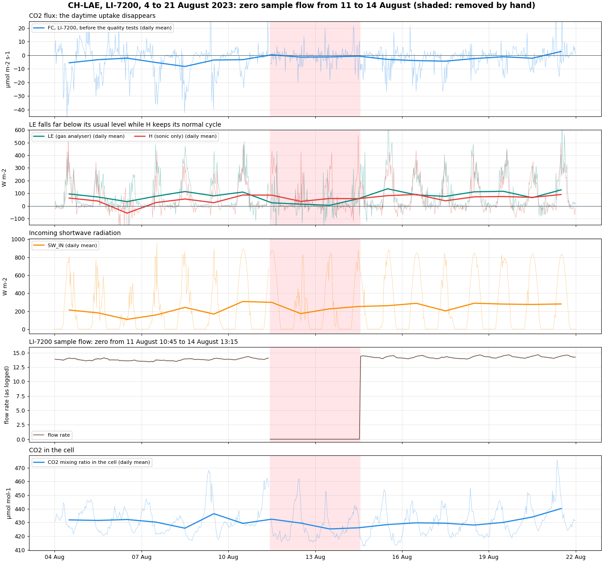
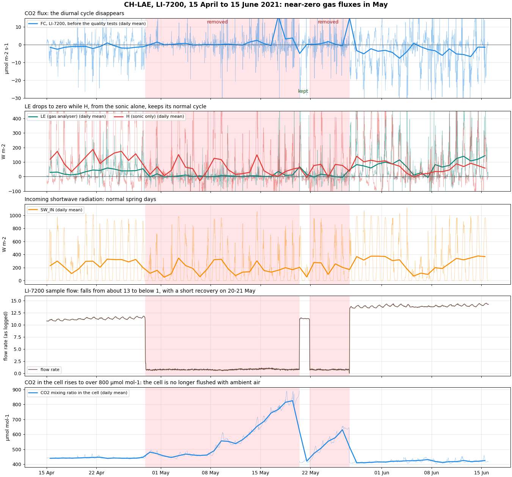
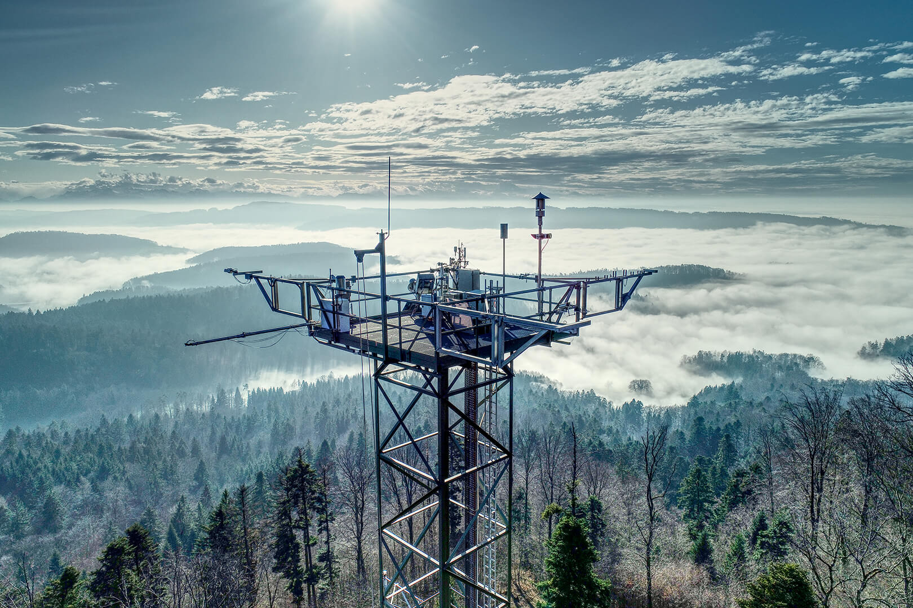
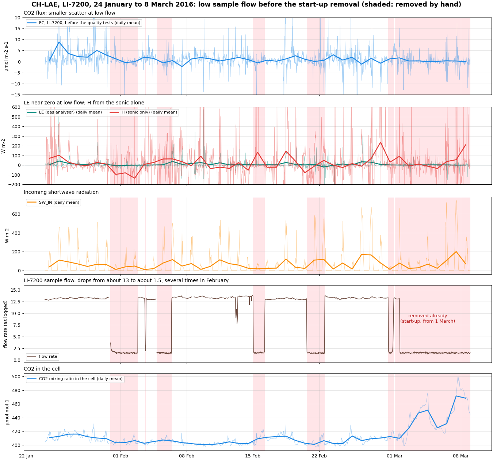
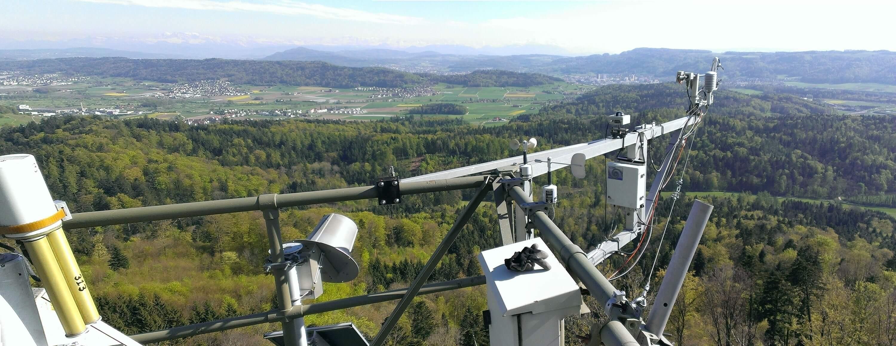
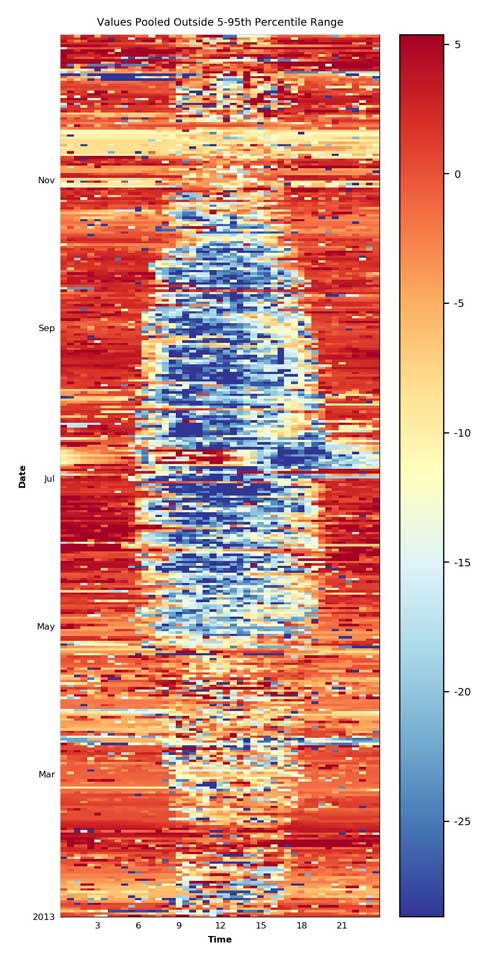

# Yearly Notes

This page lists the eddy covariance setup periods and, for each year, the flux versions, the
software used and notes on specific periods.

- FP2026.1 (2016 to September 2026) takes its fluxes from a Level-1 re-run of the whole `IRGA72`
  record in September and October 2026, one EddyPro run per setup period. Release details are in
  [Dataset versions](Dataset_Versions.md).
- FP2026.2 (in progress) takes its `IRGA75` fluxes from a Level-1 re-run of the whole `IRGA75`
  record in October 2026, also one EddyPro run per setup period. Its merged record uses them for
  2004 to 2015. The runs are listed on [Level-1: EddyPro settings](L1_EddyPro_Settings.md).
- The year sections list the earlier flux versions and notes on specific periods. The notes cover
  each instrument problem and each period removed by hand, with the evidence and the exact ranges.
  [Level-3.2](L3.2.md#instrument-problems-and-periods-removed-by-hand) lists them in one table.
- The numbered notes of the setup table, `(1)` to `(24)`, are defined in the
  [setup table on the Swiss FluxNet site page](https://www.swissfluxnet.ethz.ch/index.php/sites/site-info-ch-lae/ec-raw-binary-format-ch-lae/).
  They describe corrections, unusable periods and time-lag settings. Read each setup period
  together with its notes.
- The flux levels are defined in the
  [Swiss FluxNet Flux Processing Chain](https://www.swissfluxnet.ethz.ch/index.php/data/ecosystem-fluxes/flux-processing-chain/).
- Periods are given as raw eddy covariance file names, e.g. `2013070615.b02`. The name gives the
  start time of the file. A file typically holds 6 hours of 20 Hz data.

## Sonic anemometer

- **Model** (from the GIN fieldbook): a Gill HS-100 (serial 000027) until 19 December 2019, then a
  Gill HS-50 (serial 000063). The electronics unit of the HS-100 stayed in use until
  10 January 2020. The fieldbook has no sonic record before 2016, so it does not confirm the
  `HS50-B` in the earlier rows of the setup table. Where the fieldbook and the table disagree, the
  fieldbook is correct.
- **Height and orientation**: 47 m and 209° in all years. Histograms of wind direction for 2004 to
  2019 are very similar across years and give an orientation of 209° from north. One of the oldest
  setup files, `locations.table`, gives orientations between 183° and 209° and is not used. Note 5
  records a possible change to 206° from `2005_2`, which is not resolved.

::: {.callout-tip title="Notebooks: wind direction checks"}

- [14_IRGA75-L0_check_winddir](notebooks/00_L0_CHECKS/IRGA75/14_IRGA75-L0_check_winddir.html)
- [04_IRGA72-L0_check_winddir_2016-2026.09](notebooks/00_L0_CHECKS/IRGA72/04_IRGA72-L0_check_winddir_2016-2026.09.html)

:::

## Abbreviations

- `EC`: eddy covariance
- `FF-`: final fluxes
- `IRGA`: infrared gas analyser, used for the fluxes of CO~2~ and H~2~O (`LE`, latent heat;
  `ET`, evapotranspiration)
- `SA`: sonic anemometer, used for the sensible heat flux `H`
- `IRGA75`: open-path LI-7500; `IRGA72`: enclosed-path LI-7200

## Earlier datasets

- `Level-3-4_FLUXNET-WW2020_RELEASE-2022-1_FN-20220209`: [ICOS/FLUXNET Warm Winter 2020 ecosystem eddy covariance flux product](https://doi.org/10.18160/2G60-ZHAK)
- `Level-3-4_FLUXNET2015-FN-20190606-beta-3`: [FLUXNET Drought-2018 ecosystem eddy covariance flux product](https://doi.org/10.18160/YVR0-4898)
- `Level-3-4_FLUXNET2015-FN-20161021`: [FLUXNET2015 Dataset](https://fluxnet.org/data/fluxnet2015-dataset/), described in [Pastorello et al. (2020)](https://doi.org/10.1038/s41597-020-0534-3)
- `Level-3-4_FLUXNET-CH4-2020_V1_2012-2016`: [FLUXNET-CH4 Community Product](https://fluxnet.org/data/fluxnet-ch4-community-product/)
- [CH-LAE FP2021 (2004-2020): PI dataset](https://www.swissfluxnet.ethz.ch/index.php/documentation/ch-lae-fp2021-2004-2020/)
- [CH-LAE FP2022 (2004-2022)](https://doi.org/10.3929/ethz-b-000582198)

## Setup EC

| Year   | Binaries From  | Binaries To    | BICO | SA     | GA1          | GA2          | FR      | SA ORI     | GA1 SEP                   | GA2 SEP                   | NOTES        |
| ------ | -------------- | -------------- | ---- | ------ | ------------ | ------------ | ------- | ---------- | ------------------------- | ------------------------- | ------------ |
| 2004_1 | 2004033014.b16 | 2004123123.b00 | A    | HS50-B | IRGA75-A     | \-           | A       | 47m / 209° | N+33 E0 V-5               | \-                        |              |
| 2005_1 | 2004123123.b00 | 2005093010.b48 | A    | HS50-B | IRGA75-A     | \-           | A       | 47m / 209° | N+33 E0 V-5               | \-                        |              |
| 2005_2 | 2005093011.b57 | 2005101111.b00 | F    | HS50-B | IRGA75-A     | QCL-L2       | B / -   | 47m / 209° |                           |                           | (1)(2)       |
| 2005_3 | 2005101111.b38 | 2005111211.b00 | G    | HS50-B | IRGA75-A     | QCL-L        | C / -   | 47m / 209° |                           |                           | (1)(3)       |
| 2005_4 | 2005111215.b55 | 2005123023.b00 | A    | HS50-B | IRGA75-A     | \-           | A       | 47m / 209° | N+33 E0 V-5               | \-                        |              |
| 2006_1 | 2006010308.b00 | 2006123123.b00 | A    | HS50-B | IRGA75-A     | \-           | A       | 47m / 209° | N+33 E0 V-5               | \-                        |              |
| 2007_1 | 2006123123.b00 | 2007123123.b00 | A    | HS50-B | IRGA75-A     | \-           | A       | 47m / 209° | N+33 E0 V-5               | \-                        |              |
| 2008_1 | 2007123123.b00 | 2008051611.b00 | A    | HS50-B | IRGA75-A     | \-           | A       | 47m / 209° | \-                        |                           |              |
| 2008_2 | 2008051617.b52 | 2008061711.b00 | H    | HS50-B | IRGA75-A     | QCL-ISO      | D / -   | 47m / 209° |                           |                           | (4)(5)       |
| 2008_3 | 2008061716.b20 | 2008063011.b00 | H    | HS50-B | IRGA75-A     | (QCL-ISO)    | D / -   | 47m / 209° |                           |                           | (6)          |
| 2008_4 | 2008063012.b58 | 2008123123.b00 | A    | HS50-B | IRGA75-A     | \-           | A       | 47m / 209° | \-                        |                           |              |
| 2009_1 | 2008123123.b00 | 2009123123.b00 | A    | HS50-B | IRGA75-A     | \-           | A       | 47m / 209° | \-                        |                           |              |
| 2010_1 | 2009123123.b00 | 2010123123.b00 | A    | HS50-B | IRGA75-A     | \-           | A       | 47m / 209° | \-                        |                           |              |
| 2011_1 | 2010123123.b00 | 2011123120.b00 | A    | HS50-B | IRGA75-A     | \-           | A       | 47m / 209° | \-                        |                           |              |
| 2012_1 | 2011123120.b00 | 2012123120.b00 | A    | HS50-B | IRGA75-A     | \-           | A       | 47m / 209° | \-                        |                           |              |
| 2013_1 | 2012123120.b00 | 2013123120.b00 | A    | HS50-B | IRGA75-A     | \-           | A       | 47m / 209° | \-                        |                           | (8)          |
| 2014_1 | 2013123120.b00 | 2014123120.b00 | A    | HS50-B | IRGA75-A     | \-           | A       | 47m / 209° | \-                        |                           |              |
| 2015_1 | 2014123120.b00 | 2015123119.b00 | A    | HS50-B | IRGA75-A     | \-           | A       | 47m / 209° | N+33 E0 V-5               | \-                        |              |
| 2016_1 | 2015123119.b00 | 2016011113.b00 | A    | HS100  | IRGA75-A     | \-           | A       | 47m / 209° | N+33 E0 V-5               | \-                        |              |
| 2016_2 | 2016011115.b05 | 2016052601.b00 | C    | HS100  | IRGA75-A     | IRGA72-B     | E1 / E2 | 47m / 209° | N+33 E0 V-5               | N+6 E-1 V-15 TL100 TD0.53 | (20)         |
| 2016_3 | 2016052607.b00 | 2016123119.b00 | C    | HS100  | IRGA75-A     | IRGA72-B     | E1 / E2 | 47m / 209° | N+33 E0 V-5               | N+6 E-1 V-15 TL100 TD0.53 | (21)         |
| 2017_1 | 2016123119.b00 | 2017121207.L00 | C    | HS100  | IRGA75-A     | IRGA72-B     | E1 / E2 | 47m / 209° | N+33 E0 V-5               | N+6 E-1 V-15 TL100 TD0.53 | (9)          |
| 2017_2 | 2017121417.L22 | 2017123119.L00 | D    | HS100  | (IRGA75-A)   | IRGA72-B-GN1 | \- / E2 | 47m / 209° | \-                        | N+6 E-1 V-15 TL100 TD0.53 | (10)(15)     |
| 2018_1 | 2017123119.L00 | 2018013107.L00 | D    | HS100  | (IRGA75-A)   | IRGA72-B-GN1 | \- / E2 | 47m / 209° | \-                        | N+6 E-1 V-15 TL100 TD0.53 | (10)(15)     |
| 2018_2 | 2018013111.L28 | 2018051819.L00 | E    | HS100  | IRGA72-B-GN1 | \-           | F       | 47m / 209° | N+6 E-1 V-15 TL100 TD0.53 | \-                        | (11)(15)(19) |
| 2018_3 | 2018051901.L00 | 2018060707.L00 | E    | HS100  | IRGA72-B-GN1 | \-           | F       | 47m / 209° | N+6 E-1 V-15 TL100 TD0.53 | \-                        | (15)(19)     |
| 2018_4 | 2018060713.L00 | 2018123119.L00 | E    | HS100  | IRGA72-B-GN1 | \-           | F       | 47m / 209° | N+6 E-1 V-15 TL100 TD0.53 | \-                        | (15)         |
| 2019_1 | 2018123119.L00 | 2019011013.L00 | E    | HS100  | IRGA72-B-GN1 | \-           | F       | 47m / 209° | N+6 E-1 V-15 TL100 TD0.53 | \-                        | (15)         |
| 2019_2 | 2019011015.L54 | 2019011707.L00 | E    | HS100  | IRGA72-B-GN1 | \-           | F2      | 47m / 209° | N+6 E-1 V-15 TL100 TD0.53 | \-                        | (15)(13)(17) |
| 2019_3 | 2019011713.L22 | 2019032007.L00 | A    | HS100  | IRGA75-A     | \-           | A       | 47m / 209° | N+33 E0 V-5               | \-                        | (16)(24)     |
| 2019_4 | 2019032019.L00 | 2019123119.L00 | B    | HS100, HS50 | IRGA72-A     | \-           | G       | 47m / 209° | N+6 E-1 V-15 TL100 TD0.53 | \-                        | (14)(18)     |
| 2020_1 | 2019123119.L00 | 2020123119.L00 | B    | HS50   | IRGA72-A     | \-           | G       | 47m / 209° | N+6 E-1 V-15 TL100 TD0.53 | \-                        |              |
| 2021_1 | 2020123119.L00 | 2021121313.L00 | B    | HS50   | IRGA72-A     | \-           | G       | 47m / 209° | N+6 E-1 V-15 TL100 TD0.53 | \-                        |              |
| 2021_2 | 2021121415.L51 | 2021123119.L00 | ?    | HS50   | IRGA72-A     | \-           | G       | 47m / 209° | N+6 E-1 V-15 TL100 TD0.53 | \-                        | (22)         |
| 2022_1 | 2021123119.L00 | 2022020215.L26 | ?    | HS50   | IRGA72-A     | \-           | G       | 47m / 209° | N+6 E-1 V-15 TL100 TD0.53 | \-                        | (22)         |
| 2022_2 | 2022020710.L59 | 2022030910.L26 | B    | HS50   | IRGA72-A     | \-           | G4      | 47m / 209° | N+6 E-1 V-15 TL100 TD0.53 | \-                        | (12)         |
| 2022_3 | 2022030911.L07 | 2022111719.L00 | B    | HS50   | IRGA72-A     | \-           | G       | 47m / 209° | N+6 E-1 V-15 TL100 TD0.53 | \-                        | (7)          |
| 2022_4 | 2022111801.L00 | 2022123119.L00 | B    | HS50   | IRGA72-A     | \-           | G3      | 47m / 209° | N+6 E-1 V-15 TL100 TD0.53 | \-                        | (7)          |
| 2023_1 | 2022123113.L00 | 2023031313.L00 | B    | HS50   | IRGA72-A     | \-           | G       | 47m / 209° | N+6 E-1 V-15 TL100 TD0.53 | \-                        |              |
| 2023_2 | 2023031319.L00 | 2023123119.L00 | B    | HS50   | IRGA72-A     | \-           | G2      | 47m / 209° | N+11 E+1 V-1 TL100 TD0.53 | \-                        | (23)         |
| 2024_1 | 2023123119.L00 | 2024123119.L00 | B    | HS50   | IRGA72-A     | \-           | G2      | 47m / 209° | N+11 E+1 V-1 TL100 TD0.53 | \-                        |              |
| 2025_1 | 2024123119.L00 | 2025123119.L00 | tbc  | HS50   | IRGA72-A     | \-           | G2      | 47m / 209° | N+11 E+1 V-1 TL100 TD0.53 | \-                        | (a)          |
| 2026_1 | 2025123119.L00 | 2026093019.L00 | tbc  | HS50   | IRGA72-A tbc | \-           | tbc     | 47m / 209° | N+11 E+1 V-1 TL100 TD0.53 | \-                        | (a)          |

: EC setup periods. `tbc`: to be checked. {#tbl-setup-ec}

Notes on the table:

- The raw-file ranges of `2025_1` and `2026_1`, and their sonic model, height, orientation and
  analyser separation, come from the Level-1 EddyPro output: the names of the first and last raw
  files processed, and the instrument metadata of each run. `2026_1` is processed up to the raw
  file that starts on 30 September 2026 at 19:00. The `BICO` and `FR` configuration letters have
  no published legend and are still to be checked for these two periods.
- The end of `2022_4` was previously given as `2023123119.L00`. The Level-1 run of `2022_4` ends
  with the raw file that starts on 31 December 2022 at 19:00, so the table now gives
  `2022123119.L00`.
- **(a)** The fieldbook records that a freshly calibrated LI-7200RS head (72H0577) with analyser
  unit AIU2485 was installed at 47 m on **2 December 2025**, within `2025_1`. Whether this is a
  setup boundary is still to be checked; the Level-1 run of `2025_1` covers the whole year as one
  run.

***
## 2026

### Raised scatter in January 2026 {#raised-scatter-in-january-2026}

- From 15 January to 4 February 2026, the nighttime scatter of `FC` from the LI-7200 (`IRGA72`)
  was about twice its seasonal level, also after the outlier tests. Winter daytime values exceeded
  20 µmol m-2 s-1.
- The signal strength fell from 93 to 87. The scatter ended when the LI-7200 was cleaned on
  4 February.
- `FC` and `LE` of 15 January to 4 February are removed by hand at Level 3.2.

***
## 2025

### Level-1 fluxes for FLUXNET

These fields come partly from an unedited template and are still to be checked; the instruments
and the setup link are corrected. FP2026.1 takes the fluxes of this year from the 2026 Level-1
re-run.

- **Setup**: [EC raw binary format for CH-LAE](https://www.swissfluxnet.ethz.ch/index.php/sites/site-info-ch-lae/ec-raw-binary-format-ch-lae/)
- **Instruments**: HS50, IRGA72
- **Scripts**: [bico](https://github.com/holukas/bico) v1.6.5, [fluxrun](https://github.com/holukas/fluxrun) v1.4.1 ([EddyPro](https://www.licor.com/env/products/eddy-covariance/eddypro) v7.0.9)
- **FLUXNET upload**: 20 Apr 2025
- **Notes**: calculated without angle-of-attack correction

***
## 2024

### Level-1 fluxes for FLUXNET

These fields come partly from an unedited template and are still to be checked; the instruments
and the setup link are corrected. FP2026.1 takes the fluxes of this year from the 2026 Level-1
re-run.

- **Setup**: [EC raw binary format for CH-LAE](https://www.swissfluxnet.ethz.ch/index.php/sites/site-info-ch-lae/ec-raw-binary-format-ch-lae/)
- **Instruments**: HS50, IRGA72
- **Scripts**: [bico](https://github.com/holukas/bico) v1.6.5, [fluxrun](https://github.com/holukas/fluxrun) v1.4.1 ([EddyPro](https://www.licor.com/env/products/eddy-covariance/eddypro) v7.0.9)
- **FLUXNET upload**: 20 Apr 2025
- **Notes**: calculated without angle-of-attack correction

***
## 2023

### Level-1 fluxes for FLUXNET

These fields come partly from an unedited template and are still to be checked; the instruments
and the setup link are corrected. FP2026.1 takes the fluxes of this year from the 2026 Level-1
re-run.

- **Setup**: [EC raw binary format for CH-LAE](https://www.swissfluxnet.ethz.ch/index.php/sites/site-info-ch-lae/ec-raw-binary-format-ch-lae/)
- **Instruments**: HS50, IRGA72
- **Scripts**: [bico](https://github.com/holukas/bico) v1.6.5, [fluxrun](https://github.com/holukas/fluxrun) v1.4.1 ([EddyPro](https://www.licor.com/env/products/eddy-covariance/eddypro) v7.0.9)
- **FLUXNET upload**: 20 Apr 2025
- **Notes**: calculated without angle-of-attack correction

### Zero sample flow of the LI-7200 in August 2023 {#zero-sample-flow-of-the-li-7200-in-august-2023}

- From 11 August 10:45 to 14 August 13:15, 2023 (`TIMESTAMP_MIDDLE`), the logged sample flow of the
  LI-7200 (`IRGA72`) was zero, against about 14 before and after. The flow stopped on the day of a
  site visit. The fieldbook has no entry on the LI-7200. The signal strength changed from 93 to 100
  at the same time.
- `FC` lost most of its daytime uptake. Its mean from 10:00 to 14:00 was −2 to −4 µmol m-2 s-1,
  against −13 to −25 on the four days before and the three days after. `LE` in the same hours was
  3 to 87 W m-2, against 236 to 431. `H`, from the sonic anemometer alone, and the incoming
  shortwave radiation stayed normal. Unlike in [May 2021](#low-sample-flow-of-the-li-7200-in-may-2021),
  the CO2 mixing ratio in the cell stayed normal.
- `FC` and `LE` of this period are removed by hand at Level 3.2. `H` is kept.

### Deprecated versions

- **FF-202407**: Final Flux Version HS50_IRGA72_FF-202407

***
## 2022

### Low sample flow of the LI-7200 in December 2022 {#low-sample-flow-of-the-li-7200-in-december-2022}

- From 5 to 20 December 2022 the logged sample flow of the LI-7200 (`IRGA72`) was low and
  intermittent, mostly 0 to 3 from 8 to 19 December. At this flow, ambient air no longer flushes
  the measuring cell.
- The nighttime `NEE` kept after all quality tests is +5 to +16 µmol m-2 s-1 at about -8 °C, far
  above a plausible winter respiration.
- `FC` and `LE` are removed by hand at Level 3.2 from 2022-12-05 17:15 to 2022-12-20 11:15
  (`TIMESTAMP_MIDDLE`, both ends included). `H` is kept. FP2026.1 still contains these values
  ([Issues](Issues.md#faulty-sample-flow-of-the-li-7200-in-december-2022)).
- From March to November 2022 the flow channel reads 0.0 while the fluxes are normal, a logging
  fault of the channel. The logged flow of this period cannot be used to find flow faults.

### Level-1 fluxes for FLUXNET

These fields come partly from an unedited template and are still to be checked; the instruments
and the setup link are corrected. FP2026.1 takes the fluxes of this year from the 2026 Level-1
re-run.

- **Setup**: [EC raw binary format for CH-LAE](https://www.swissfluxnet.ethz.ch/index.php/sites/site-info-ch-lae/ec-raw-binary-format-ch-lae/)
- **Instruments**: HS50, IRGA72
- **Scripts**: [bico](https://github.com/holukas/bico) v1.6.5, [fluxrun](https://github.com/holukas/fluxrun) v1.4.1 ([EddyPro](https://www.licor.com/env/products/eddy-covariance/eddypro) v7.0.9)
- **FLUXNET upload**: 20 Apr 2025
- **Notes**: calculated without angle-of-attack correction

### Deprecated versions

- **FF-202306**: Final Flux Version HS50_IRGA72_FF-202306

***
## 2021

### Level-1 fluxes for FLUXNET

These fields come partly from an unedited template and are still to be checked; the instruments
and the setup link are corrected. FP2026.1 takes the fluxes of this year from the 2026 Level-1
re-run.

- **Setup**: [EC raw binary format for CH-LAE](https://www.swissfluxnet.ethz.ch/index.php/sites/site-info-ch-lae/ec-raw-binary-format-ch-lae/)
- **Instruments**: HS50, IRGA72
- **Scripts**: [bico](https://github.com/holukas/bico) v1.6.5, [fluxrun](https://github.com/holukas/fluxrun) v1.4.1 ([EddyPro](https://www.licor.com/env/products/eddy-covariance/eddypro) v7.0.9)
- **FLUXNET upload**: 20 Apr 2025
- **Notes**: calculated without angle-of-attack correction

### Low sample flow of the LI-7200 in May 2021 {#low-sample-flow-of-the-li-7200-in-may-2021}

- From 28 April to 27 May 2021 the sample flow of the LI-7200 (`IRGA72`) fell from its usual 11
  to 14 to below 1 (logged flow rate). It was normal again for one day, from 20 May 11:15 to
  21 May 21:15.
- At this flow, ambient air no longer flushes the measuring cell. The CO2 mixing ratio in the cell
  rose to over 800 µmol mol-1, and `FC` and `LE` lost their diurnal cycle and stayed near zero.
  `H`, from the sonic anemometer alone, and the incoming shortwave radiation stayed normal. The
  values passed the automatic tests because a flux near zero lies within every limit.
- `FC` and `LE` of the two low-flow periods are removed by hand at Level 3.2: 2021-04-28 20:15 to
  2021-05-20 11:15 and 2021-05-21 21:45 to 2021-05-27 11:45 (`TIMESTAMP_MIDDLE`). The day of
  normal flow between them is kept, and so is `H`.

***
## 2020

### Gas analyser fault in November 2020 {#gas-analyser-fault-in-november-2020}

- From 8 November to 6 December 2020, the scatter of `FC` from the LI-7200 (`IRGA72`) rose to many
  times its usual level, with half-hourly values from −190 to +190 µmol m-2 s-1. The flow rate and
  the sonic anemometer stayed normal. `LE` exceeded the incoming radiation and scattered at night.
- The signal strength fell from 100 to about 60 on 12 November. It recovered after the LI-7200 was
  replaced on 10 December.
- `FC` and `LE` of 8 to 27 November and 4 to 6 December are removed by hand at Level 3.2. The days
  between them are within the usual scatter. `H` is kept.

### Deprecated versions

| Version | `HS50-IRGA72_FF-202101` | `FF-202008` | `FF-202006` |
| --- | --- | --- | --- |
| Level-1 ID | Level-1_FR-20210419-120722 | Level-1_ID2020-08-12T001439 | Level-1_ID2020-06-15T110137 |
| Level-1.1 ID |  |  | none (no self-heating correction applied) |
| Level-4 IDs | [CH-LAE FP2021 (2004-2020)](https://www.swissfluxnet.ethz.ch/index.php/documentation/ch-lae-fp2021-2004-2020/) (PI dataset); [Level-3-4_FLUXNET-WW2020_RELEASE-2022-1_FN-20220209](https://www.icos-cp.eu/data-products/2G60-ZHAK) | Level-3-4_FLUXNET2015-WW2020-FN-20201217_beta-3_2004-2020.06 | Level-3-4_FLUXNET2015-WW2020-FN-20201217_beta-3_2004-2020.06 |
| Setup | [Setup since 2004](https://www.swissfluxnet.ethz.ch/index.php/sites/ch-lae-laegeren/data-ch-lae/ec-raw-binary-format-ch-lae/) | [Setup since 2004](https://www.swissfluxnet.ethz.ch/index.php/sites/ch-lae-laegeren/data-ch-lae/ec-raw-binary-format-ch-lae/) | [Setup since 2004](https://www.swissfluxnet.ethz.ch/index.php/sites/ch-lae-laegeren/data-ch-lae/ec-raw-binary-format-ch-lae/) |
| Period |  | 2020, up to and including 30 Jun 2020 | 2020, up to and including 31 May 2020 |
| Instruments | HS50, IRGA72 | HS50, IRGA72 | HS50, IRGA72 |
| Scripts | [EddyPro](https://www.licor.com/env/products/eddy_covariance/eddypro) 7.0.6 (Level-1), [BICO](https://gitlab.ethz.ch/holukas/bico) v0.5.0, [FLUXRUN](https://gitlab.ethz.ch/holukas/fluxrun) v0.5.0, [diive](https://github.com/holukas/diive) v0.17.0, [ReddyProc](https://cran.r-project.org/web/packages/REddyProc/index.html) 1.2 (post-processing PI dataset) | [FCT 0.9.6](https://gitlab.ethz.ch/holukas/fct-flux-calculation-tool/-/releases/v0.9.6), [EddyPro](https://www.licor.com/env/products/eddy_covariance/eddypro) 7.0.6, [diive](https://github.com/holukas/diive) v0.16.0 | [FCT 0.9.6](https://gitlab.ethz.ch/holukas/fct-flux-calculation-tool/-/releases/v0.9.6) with [EddyPro](https://www.licor.com/env/products/eddy_covariance/eddypro) v7.0.6 (Level-1), [FQC 2.1.2](https://gitlab.ethz.ch/holukas/fqc-flux-quality-control/-/releases/v2.1.2) (Level-2) |
| FLUXNET upload | 09 Jun 2021 (Level-1) | 13 Aug 2020 (Level-1) | not uploaded (originally meant for the ICOS Winter 2020 Initiative) |
| Notes | Updated during the creation of the PI dataset. Fluxes from the open-path LI-7500 (IRGA75) are corrected for self-heating. Flux levels: [Flux Processing Chain](https://www.swissfluxnet.ethz.ch/index.php/data/ecosystem-fluxes/flux-processing-chain/). | Recalculated to include all fluxes up to 30 Jun 2020, as needed for the ICOS Winter 2020 Initiative. More information: [CH-MULTI / FF-202008](https://www.swissfluxnet.ethz.ch/index.php/documentation/ch-multi-ff-202008/). | Level-1 fluxes up to and including 31 May 2020. Screened meteo data were available only up to and including 27 May 2020 13:30, so the Level-2 fluxes end at that date. The fluxes were intended for the ICOS Winter 2020 dataset but not used; FF-202008, with a longer period, was uploaded instead. More information: CH-LAE / FF-202006. |

***
## 2019

### Sonic electronics, December 2019 to January 2020 {#sonic-electronics-december-2019-to-january-2020}

- The HS-100 was replaced by the HS-50 on 19 December 2019 (see
  [Instrumentation](Instrumentation.md)), but the electronics unit of the HS-100 stayed in use
  until 10 January 2020. The fieldbook therefore rates these data as possibly not entirely
  accurate.
- `H` of this period does not differ from the weeks around it and is kept.

### Deprecated versions

| Version | `HS50-IRGA72-IRGA75_FF-202101` | `HS50-IRGA75-IRGA72_FF-202006` |
| --- | --- | --- |
| Level-1 ID | Level-1_DIIVE-20210607-093449 (merged results from Level-1 IRGA72 fluxes and Level-1.1 IRGA75 fluxes) | Level-1_ID2020-06-27T001433 |
| Level-1.1 ID | only IRGA75: [CH-LAE FP2021 (2004-2020)](https://www.swissfluxnet.ethz.ch/index.php/documentation/ch-lae-fp2021-2004-2020/) | none (no self-heating correction applied) |
| Level-4 IDs | [CH-LAE FP2021 (2004-2020)](https://www.swissfluxnet.ethz.ch/index.php/documentation/ch-lae-fp2021-2004-2020/) (PI dataset); [Level-3-4_FLUXNET-WW2020_RELEASE-2022-1_FN-20220209](https://www.icos-cp.eu/data-products/2G60-ZHAK) | Level-3-4_FLUXNET2015-WW2020-FN-20201217_beta-3_2004-2020.06 |
| Setup | [Setup since 2004](https://www.swissfluxnet.ethz.ch/index.php/sites/ch-lae-laegeren/data-ch-lae/ec-raw-binary-format-ch-lae/) | [Setup since 2004](https://www.swissfluxnet.ethz.ch/index.php/sites/ch-lae-laegeren/data-ch-lae/ec-raw-binary-format-ch-lae/) |
| Period | 2019 (complete year) | 2019 (complete year) |
| Instruments | HS50, IRGA72, IRGA75 | HS50, IRGA75, IRGA72 |
| Scripts | [EddyPro](https://www.licor.com/env/products/eddy_covariance/eddypro) 7.0.6 (Level-1), [FCT](https://gitlab.ethz.ch/holukas/fct-flux-calculation-tool) 0.9.6, [diive](https://github.com/holukas/diive) v0.19.0-alpha, [ReddyProc](https://cran.r-project.org/web/packages/REddyProc/index.html) 1.2 (post-processing PI dataset) | [FCT 0.9.6](https://gitlab.ethz.ch/holukas/fct-flux-calculation-tool/-/releases/v0.9.6) with EP 7.0.6 (Level-1), [FIME 1.0.0](https://gitlab.ethz.ch/holukas/fime-file-merger/-/releases/v1.0.0) (merging Level-1), [FQC 2.1.1](https://gitlab.ethz.ch/holukas/fqc-flux-quality-control/-/releases/v2.1.1) (Level-2), Amp v0.16.0 |
| FLUXNET upload | 09 Jun 2021 (merged Level-1 IRGA72 and Level-1.1 IRGA75 fluxes for the full FLUXNET Warm Winter 2020 dataset) | 13 Aug 2020 (Level-1) |
| Notes | For the period 2019_3, IRGA75 fluxes corrected for self-heating were used. They come from FF-202006 / Level-1_ID2020-06-27T001433 (next column); for this release, the IRGA75 fluxes of that run were corrected for self-heating. Updated during the creation of the PI dataset. Flux levels: [Flux Processing Chain](https://www.swissfluxnet.ethz.ch/index.php/data/ecosystem-fluxes/flux-processing-chain/). | Corrected for the [Wrong Calibration Gas 2017](https://www.swissfluxnet.ethz.ch/index.php/documentation/wrong-calibration-gas-2017/) issue. Affected periods: [Setup since 2004](https://www.swissfluxnet.ethz.ch/index.php/sites/ch-lae-laegeren/data-ch-lae/ec-raw-binary-format-ch-lae/). |

***
## 2018

### Flow module failure in May and June 2018 {#flow-module-failure-in-may-and-june-2018}

- The flow module of the LI-7200 (`IRGA72`) was defective from 19 May to 7 June 2018. This period
  was processed with the sonic anemometer only, so it has `H` but no `FC` and no `LE`.
- The sample flow had already fallen before the failure:
  - On 17 May it dropped from about 13.6 to zero between 07:15 and 16:45, then recovered for one
    night. From 18 May 07:45 it stayed at zero.
  - `FC` and `LE` were still recorded in these hours and are erratic. They are removed by hand at
    Level 3.2: 2018-05-17 07:15 to 16:45 and 2018-05-18 07:45 to 2018-05-19 11:45
    (`TIMESTAMP_MIDDLE`). The night of 17 to 18 May is kept.
- The low `LE` of 13 to 16 May is not a fault. The flow was normal, and these were cool, overcast
  days with little radiation.

### Failing LI-7200, December 2018 to January 2019 {#failing-li-7200-december-2018-to-january-2019}

- From December 2018 the LI-7200 (IRGA72-B) was failing: low signal strength, an iced inlet
  filter, error codes and repeated stops of the data acquisition. It was replaced on 11 January
  2019.
- `FC` and `LE` of 30 December 2018 to 10 January 2019 are removed by hand at Level 3.2.
- From 20 to 26 December 2018, after work on the LI-7200, the instrument boom was not fixed in
  position, so the sonic anemometer could move with it. `H` of these days is removed by hand.

### Wrong calibration gas, December 2017 to March 2019 {#wrong-calibration-gas-december-2017-to-march-2019}

- The CO2 concentrations from 14 December 2017 to 15 March 2019 were calibrated against the wrong
  reference gas. The correction, a factor of 0.974 on the concentration, was applied when bico
  converted the raw data, so `FC` is corrected. Nothing is removed.

### Deprecated versions

| Version | `HS50-IRGA72_FF-202101` | `HS50-IRGA72_FF-201902` |
| --- | --- | --- |
| Level-1 ID | Level-1_DIIVE-20210607-093447 | Level-1_ID2019-01-15T155533 |
| Level-4 IDs | [CH-LAE FP2021 (2004-2020)](https://www.swissfluxnet.ethz.ch/index.php/documentation/ch-lae-fp2021-2004-2020/) (PI dataset); [Level-3-4_FLUXNET-WW2020_RELEASE-2022-1_FN-20220209](https://www.icos-cp.eu/data-products/2G60-ZHAK) | Level-3-4_FLUXNET2015-FN-20190607-beta-3_2004-2018; Level-3-4_FLUXNET2015-WW2020-FN-20201217_beta-3_2004-2020.06 |
| Setup | [Setup since 2004](https://www.swissfluxnet.ethz.ch/index.php/sites/ch-lae-laegeren/data-ch-lae/ec-raw-binary-format-ch-lae/) | [Setup since 2004](https://www.swissfluxnet.ethz.ch/index.php/sites/ch-lae-laegeren/data-ch-lae/ec-raw-binary-format-ch-lae/) |
| Period | 2018 (complete year) | 2018 (complete year) |
| Instruments | HS50, IRGA72 | HS50, IRGA72 |
| Scripts | [EddyPro](https://www.licor.com/env/products/eddy_covariance/eddypro) 7.0.6 (Level-1), [BICO](https://gitlab.ethz.ch/holukas/bico) v0.5.1, [FLUXRUN](https://gitlab.ethz.ch/holukas/fluxrun) v0.5.0, [diive](https://github.com/holukas/diive) v0.19.0-alpha, [ReddyProc](https://cran.r-project.org/web/packages/REddyProc/index.html) 1.2 (post-processing PI dataset) | [FCT](https://gitlab.ethz.ch/holukas/fct-flux-calculation-tool) 0.85, [EddyPro](https://www.licor.com/env/products/eddy_covariance/eddypro) 6.2.0 (Level-1), [FQC](https://gitlab.ethz.ch/holukas/fqc-flux-quality-control) (Level-2) |
| FLUXNET upload | 09 Jun 2021 (Level-1) | 6 May 2019 (Level-1) |
| Notes | Fluxes of these periods were removed because of the IRGA72 flow rate (in FP2021 they were removed in the Level-2 fluxes): CO2 flux 19 May to 6 Jun 2018; water fluxes (H2O flux, LE, ET) 13 May to 6 Jun 2018 (in FP2021 only needed for LE). Corrected for the [Wrong Calibration Gas](https://www.swissfluxnet.ethz.ch/index.php/documentation/wrong-calibration-gas-2017/). Updated during the creation of the PI dataset. Flux levels: [Flux Processing Chain](https://www.swissfluxnet.ethz.ch/index.php/data/ecosystem-fluxes/flux-processing-chain/). | Known issues: (1) not corrected for the [Wrong Calibration Gas 2017](https://www.swissfluxnet.ethz.ch/index.php/documentation/wrong-calibration-gas-2017/) issue, which was unknown at the time; affected periods: [Setup since 2004](https://www.swissfluxnet.ethz.ch/index.php/sites/ch-lae-laegeren/data-ch-lae/ec-raw-binary-format-ch-lae/). (2) The flow of the LI-7200 was obstructed from 31 May to 7 June 2018, which leads to faulty CO2 and H2O fluxes; a quality check found this in February 2019. Users of this version should flag that period as 2 or set it to missing. |

***
## 2017

### Deprecated versions

| Version | `HS50-IRGA72-IRGA75_FF-202101` | `FF-201902` |
| --- | --- | --- |
| Level-1 ID | Level-1_DIIVE-20210606-105902 (merged results from Level-1 IRGA72 fluxes and Level-1.1 IRGA75 fluxes), Level-1_2017_1_2_IRGA72_FR-20210423-160035, Level-1.1_2017_IRGA75_DIIVE-20210606-105901 | Level-1_ID2018-03-02T095006 |
| Level-1.1 ID | only IRGA75: [CH-LAE FP2021 (2004-2020)](https://www.swissfluxnet.ethz.ch/index.php/documentation/ch-lae-fp2021-2004-2020/) |  |
| Level-4 IDs | [CH-LAE FP2021 (2004-2020)](https://www.swissfluxnet.ethz.ch/index.php/documentation/ch-lae-fp2021-2004-2020/) (PI dataset); [Level-3-4_FLUXNET-WW2020_RELEASE-2022-1_FN-20220209](https://www.icos-cp.eu/data-products/2G60-ZHAK) | Level-3-4_FLUXNET2015-FN-20190607-beta-3_2004-2018; Level-3-4_FLUXNET2015-WW2020-FN-20201217_beta-3_2004-2020.06 |
| Setup | [Setup since 2004](https://www.swissfluxnet.ethz.ch/index.php/sites/ch-lae-laegeren/data-ch-lae/ec-raw-binary-format-ch-lae/) | [Setup since 2004](https://www.swissfluxnet.ethz.ch/index.php/sites/ch-lae-laegeren/data-ch-lae/ec-raw-binary-format-ch-lae/) |
| Period | 2017 (complete year) | 2017 (only IRGA72 used, complete year) |
| Instruments | HS50, IRGA75, IRGA72 | HS50, IRGA72 |
| Scripts | [EddyPro](https://www.licor.com/env/products/eddy_covariance/eddypro) 7.0.6 (Level-1), [BICO](https://gitlab.ethz.ch/holukas/bico) v0.5.1, [FLUXRUN](https://gitlab.ethz.ch/holukas/fluxrun) v0.5.0, [diive](https://github.com/holukas/diive) v0.19.0-alpha, [SCOP](https://gitlab.ethz.ch/holukas/scop) v0.1 (self-heating correction), [ReddyProc](https://cran.r-project.org/web/packages/REddyProc/index.html) 1.2 (post-processing PI dataset) | [FCT](https://gitlab.ethz.ch/holukas/fct-flux-calculation-tool) 0.74, [EddyPro](https://www.licor.com/env/products/eddy_covariance/eddypro) 6.1.0 (Level-1), [FQC](https://gitlab.ethz.ch/holukas/fqc-flux-quality-control) (Level-2) |
| FLUXNET upload | 09 Jun 2021 (merged Level-1 IRGA72 and Level-1.1 IRGA75 fluxes for the full FLUXNET Warm Winter 2020 dataset) | 23 May 2019 (Level-1) |
| Notes | IRGA72 fluxes are prioritized. The few gaps in the IRGA72 fluxes were filled with IRGA75 fluxes (corrected for self-heating) where these were available. Separate Level-1 fluxes for IRGA72 and IRGA75 are available in HS50-IRGA72-IRGA75_FF-202101, and Level-1.1 fluxes for IRGA75. The short period at the end of the year affected by the [Wrong Calibration Gas](https://www.swissfluxnet.ethz.ch/index.php/documentation/wrong-calibration-gas-2017/) is corrected. Updated during the creation of the PI dataset. Fluxes from the open-path LI-7500 (IRGA75) are corrected for self-heating. Flux levels: [Flux Processing Chain](https://www.swissfluxnet.ethz.ch/index.php/data/ecosystem-fluxes/flux-processing-chain/). | Known issues: not corrected for the [Wrong Calibration Gas 2017](https://www.swissfluxnet.ethz.ch/index.php/documentation/wrong-calibration-gas-2017/) issue, which was unknown at the time; affected periods: [Setup since 2004](https://www.swissfluxnet.ethz.ch/index.php/sites/ch-lae-laegeren/data-ch-lae/ec-raw-binary-format-ch-lae/). The issue affects only about the last 2 weeks of December, so a correction might not be worthwhile: its impact on CO2 budgets is virtually zero. Not all details of this upload are available. The file in the database upload indicates that the IRGA72 fluxes were uploaded. Some files are missing in the output folder (the converted raw data csv files and the raw data csv plots). The Level-2 fluxes are missing, but data were uploaded. There was no log file, so the versions of FCT and EddyPro used are unknown (probably FCT 0.74, EP 6.1.0). |

***
## 2016

### Start-up of the LI-7200 in 2016 {#start-up-of-the-li-7200-in-2016}

- The LI-7200 (`IRGA72`) was installed from 11 to 22 January 2016. During the installation, water
  in the filter lowered the fluxes.
- From 30 January to 26 May 2016 the logged sample flow repeatedly fell from about 13 to about 1.5:
  six times in February, each for a few hours to two days, and without a break from 1 March. On
  26 May the fieldbook records the inlet filter as nearly fully blocked and a lot of water in the
  filter after the cell. After the filter was removed, the flow was normal again from 08:15.
- At this flow, `LE` was close to zero: in February its daytime median was 1.4 W m-2, against 20
  at normal flow. `FC` scattered less, with a nighttime median of 0.1 µmol m-2 s-1, against 1.2 at
  normal flow. From March the CO2 mixing ratio in the cell rose to up to 500 µmol mol-1. `H`, from
  the sonic anemometer alone, is not affected.
- `FC` and `LE` are removed by hand at Level 3.2 in these periods (`TIMESTAMP_MIDDLE`, both ends
  included). The periods include the records at the edges, while the flow was falling or
  recovering. `H` is kept.
  - 11 to 22 January
  - 2016-01-30 22:45 to 2016-02-02 19:45
  - 2016-02-03 14:15 to 16:45
  - 2016-02-04 20:15 to 2016-02-06 09:15
  - 2016-02-15 00:45 to 2016-02-16 06:15
  - 2016-02-20 16:45 to 2016-02-22 14:15
  - 2016-02-29 07:45 to 21:15
  - 1 March to 2016-05-26 07:45
- `LE` is also removed from 23 January to 29 February 2016, between the low-flow periods. In this
  period the H2O flux of the LI-7200 does not follow that of the LI-7500, which measured in parallel
  (slope 0.04, r 0.17), and `LE` is far too low. FP2026.1 still contains these values.

### Deprecated versions

| Version | `HS50-IRGA72-IRGA75_FF-202101` | `FF-201902` |
| --- | --- | --- |
| Level-1 ID | Level-1_DIIVE-20210606-105901 (merged results from Level-1 IRGA72 fluxes and Level-1.1 IRGA75 fluxes), Level-1_2016_2_3_IRGA72_FR-20210424-013350, Level-1.1_2016_IRGA75_DIIVE-20210606-105901 | Level-1_ID2017-02-10T101729 |
| Level-1.1 ID | only IRGA75: [CH-LAE FP2021 (2004-2020)](https://www.swissfluxnet.ethz.ch/index.php/documentation/ch-lae-fp2021-2004-2020/) | none (no self-heating correction applied) |
| Level-4 IDs | [CH-LAE FP2021 (2004-2020)](https://www.swissfluxnet.ethz.ch/index.php/documentation/ch-lae-fp2021-2004-2020/) (PI dataset); [Level-3-4_FLUXNET-WW2020_RELEASE-2022-1_FN-20220209](https://www.icos-cp.eu/data-products/2G60-ZHAK) | Level-3-4_FLUXNET2015-FN-20190607-beta-3_2004-2018; Level-3-4_FLUXNET2015-WW2020-FN-20201217_beta-3_2004-2020.06 |
| Setup | [Setup since 2004](https://www.swissfluxnet.ethz.ch/index.php/sites/ch-lae-laegeren/data-ch-lae/ec-raw-binary-format-ch-lae/) | [Setup since 2004](https://www.swissfluxnet.ethz.ch/index.php/sites/ch-lae-laegeren/data-ch-lae/ec-raw-binary-format-ch-lae/) |
| Period | 2016 (complete year) | 2016 (only IRGA75 used, complete year) |
| Instruments | HS50, IRGA75, IRGA72 | HS50, IRGA75 |
| Scripts | [EddyPro](https://www.licor.com/env/products/eddy_covariance/eddypro) 7.0.6 (Level-1), [BICO](https://gitlab.ethz.ch/holukas/bico) v0.5.1, [FLUXRUN](https://gitlab.ethz.ch/holukas/fluxrun) v0.5.0, [diive](https://github.com/holukas/diive) v0.19.0-alpha, [SCOP](https://gitlab.ethz.ch/holukas/scop) v0.1 (self-heating correction), [ReddyProc](https://cran.r-project.org/web/packages/REddyProc/index.html) 1.2 (post-processing PI dataset) | [FCT](https://gitlab.ethz.ch/holukas/fct-flux-calculation-tool) 0.74, [EddyPro](https://www.licor.com/env/products/eddy_covariance/eddypro) 6.1.0 (Level-1), [FQC](https://gitlab.ethz.ch/holukas/fqc-flux-quality-control) (Level-2) |
| FLUXNET upload | 09 Jun 2021 (merged Level-1 IRGA72 and Level-1.1 IRGA75 fluxes for the full FLUXNET Warm Winter 2020 dataset) | 23 May 2019 (Level-1) |
| Notes | IRGA72 fluxes are not available for the first few months of the year. These gaps, and other IRGA72 gaps through the rest of the year, were filled with IRGA75 fluxes (corrected for self-heating) where these were available. Separate Level-1 fluxes for IRGA72 and IRGA75 are available in HS50-IRGA72-IRGA75_FF-202101, and Level-1.1 fluxes for IRGA75. Updated during the creation of the PI dataset. Fluxes from the open-path LI-7500 (IRGA75) are corrected for self-heating. Flux levels: [Flux Processing Chain](https://www.swissfluxnet.ethz.ch/index.php/data/ecosystem-fluxes/flux-processing-chain/). | No self-heating correction was applied to the Level-1 fluxes. Not all details of this upload are available; the file in the database upload indicates that the IRGA75 fluxes were uploaded. |

***
## 2015

### Deprecated versions

| Version | `HS50-IRGA75_FF-201606` | `FF-201606` |
| --- | --- | --- |
| Level-1 ID | Level-1_ID2016-06-10T163549 | Level-1_ID2016-06-10T163549 |
| Level-1.1 ID | [CH-LAE FP2021 (2004-2020)](https://www.swissfluxnet.ethz.ch/index.php/documentation/ch-lae-fp2021-2004-2020/) | none (no self-heating correction applied) |
| Level-4 IDs | [CH-LAE FP2021 (2004-2020)](https://www.swissfluxnet.ethz.ch/index.php/documentation/ch-lae-fp2021-2004-2020/) (PI dataset); [Level-3-4_FLUXNET-WW2020_RELEASE-2022-1_FN-20220209](https://www.icos-cp.eu/data-products/2G60-ZHAK) | Level-3-4_FLUXNET2015-FN-20190607-beta-3_2004-2018; Level-3-4_FLUXNET2015-WW2020-FN-20201217_beta-3_2004-2020.06 |
| Setup | [Setup since 2004](https://www.swissfluxnet.ethz.ch/index.php/sites/ch-lae-laegeren/data-ch-lae/ec-raw-binary-format-ch-lae/) | [Setup since 2004](https://www.swissfluxnet.ethz.ch/index.php/sites/ch-lae-laegeren/data-ch-lae/ec-raw-binary-format-ch-lae/) |
| Period | 2015 (complete year) | 2015 (complete year) |
| Instruments | HS50, IRGA75 | HS50, IRGA75 |
| Scripts | [EddyPro](https://www.licor.com/env/products/eddy_covariance/eddypro) 6.1.0 (Level-1), [diive](https://github.com/holukas/diive) v0.19.0-alpha, [SCOP](https://gitlab.ethz.ch/holukas/scop) v0.1 (self-heating correction), [ReddyProc](https://cran.r-project.org/web/packages/REddyProc/index.html) 1.2 (post-processing PI dataset) | [FCT](https://gitlab.ethz.ch/holukas/fct-flux-calculation-tool) 0.74, [EddyPro](https://www.licor.com/env/products/eddy_covariance/eddypro) 6.1.0 (Level-1), [FQC](https://gitlab.ethz.ch/holukas/fqc-flux-quality-control) (Level-2) |
| FLUXNET upload | 09 Jun 2021 (Level-1.1) | 30 Jun 2016 (Level-1, for the FLUXNET2015 dataset) |
| Notes | Updated during the creation of the PI dataset. Fluxes from the open-path LI-7500 (IRGA75) are corrected for self-heating. | No self-heating correction was applied to the Level-1 fluxes. As for other sites, the 2015 fluxes were uploaded for the FLUXNET2015 dataset in 2016, but that dataset generally includes fluxes only up to and including 2014, so they were not included. They were included later, in the update of the dataset during the data collection for the drought study in 2019. |

***
## 2014

### Periods removed by hand {#removed-by-hand-2014}

- **9 to 12 November and 24 November to 7 December 2014, `IRGA75` (FP2026.2)**: fog and rime as in
  [December 2004](#removed-by-hand-2004), at 99 % relative humidity. Nighttime `NEE` reached
  −17 µmol m-2 s-1, `LE` was erratic, and AGC values reached 94. `NEE`, `LE` and `H` of these days
  are removed by hand at Level 3.2.

### Deprecated versions

| Version | `HS50-IRGA75_FF-201606` | `FF-201606` |
| --- | --- | --- |
| Level-1 ID | Level-1_ID2016-06-10T163622 | Level-1_ID2016-06-10T163622 |
| Level-1.1 ID | [CH-LAE FP2021 (2004-2020)](https://www.swissfluxnet.ethz.ch/index.php/documentation/ch-lae-fp2021-2004-2020/) | none (no self-heating correction applied) |
| Level-4 IDs | [CH-LAE FP2021 (2004-2020)](https://www.swissfluxnet.ethz.ch/index.php/documentation/ch-lae-fp2021-2004-2020/) (PI dataset); [Level-3-4_FLUXNET-WW2020_RELEASE-2022-1_FN-20220209](https://www.icos-cp.eu/data-products/2G60-ZHAK) | Level-3-4_FLUXNET2015-FN-20161021_2004-2014; Level-3-4_FLUXNET2015-FN-20190607-beta-3_2004-2018; Level-3-4_FLUXNET2015-WW2020-FN-20201217_beta-3_2004-2020.06 |
| Setup | [Setup since 2004](https://www.swissfluxnet.ethz.ch/index.php/sites/ch-lae-laegeren/data-ch-lae/ec-raw-binary-format-ch-lae/) | [Setup since 2004](https://www.swissfluxnet.ethz.ch/index.php/sites/ch-lae-laegeren/data-ch-lae/ec-raw-binary-format-ch-lae/) |
| Period | 2014 (complete year) | 2014 (complete year) |
| Instruments | HS50, IRGA75 | HS50, IRGA75 |
| Scripts | [EddyPro](https://www.licor.com/env/products/eddy_covariance/eddypro) 6.1.0 (Level-1), [diive](https://github.com/holukas/diive) v0.19.0-alpha, [SCOP](https://gitlab.ethz.ch/holukas/scop) v0.1 (self-heating correction), [ReddyProc](https://cran.r-project.org/web/packages/REddyProc/index.html) 1.2 (post-processing PI dataset) | [FCT](https://gitlab.ethz.ch/holukas/fct-flux-calculation-tool) 0.74, [EddyPro](https://www.licor.com/env/products/eddy_covariance/eddypro) 6.1.0 (Level-1), [FQC](https://gitlab.ethz.ch/holukas/fqc-flux-quality-control) (Level-2) |
| FLUXNET upload | 09 Jun 2021 (Level-1.1) | 30 Jun 2016 (Level-1) |
| Notes | Updated during the creation of the PI dataset. Fluxes from the open-path LI-7500 (IRGA75) are corrected for self-heating. | No self-heating correction was applied to the Level-1 fluxes. |

***
## 2013

### Shifted timestamps in July 2013

- **Affected raw files**: `2013070615.b02` to `2013071214.b00`, inclusive.
- The start times in the names of these raw files are 7 hours late. The fieldbook entry of
  12 July 2013 records that the clock of the data acquisition (MOXA) was wrong and was changed at
  16:44 from 22:43:50 to 15:44. In the Level-1 fluxes of 7 to 11 July, `H` lags the incoming
  shortwave radiation by 7 hours.
- The original raw files still carry the wrong names (checked July 2025). To correct the shift
  before the flux calculation, rename the files after their conversion to ASCII with bico,
  subtracting 7 hours: for example, `2013070802.b00` becomes `2013070719.b00`. Repeat this for
  every new flux calculation of this period.
- **FP2021**: the shift was still present in the IRGA75 Level-1 fluxes and was corrected after the
  flux calculation. Between 2013-07-06 15:45 and 2013-07-12 23:45 the timestamps were shifted by
  about 14.5 hours (data at 2013-07-06 15:45 belong to 2013-07-06 08:15). The Level-1 data were
  shifted accordingly, and the transition day, 12 July 2013, was set to missing.
- **FP2026.2 (`IRGA75`)**: the Level-1 run of 2013 used the files with their original names, so its
  fluxes still carry the 7-hour shift. The input notebook of the flux post-processing chain
  (`30_FLUX_POST-PROCESSING_CHAIN/IRGA75/00`) moves the flux records labelled 2013-07-06 15:15 to
  2013-07-12 19:45 (`TIMESTAMP_MIDDLE`) back by 7 hours, into the 7 empty hours that the clock
  skipped. Afterwards, `H` follows the incoming shortwave radiation without lag. The half-hours of
  12 July 2013 from 13:15 to 19:45 have no flux, because their raw data were overwritten when the
  clock was reset.

### Periods removed by hand {#removed-by-hand-2013}

- **16 to 23 November 2013, `IRGA75` (FP2026.2)**: fog and rime as in
  [December 2004](#removed-by-hand-2004), at 99 % relative humidity. Nighttime `NEE` reached
  −17 µmol m-2 s-1, `LE` was erratic, and AGC values reached 94. `NEE`, `LE` and `H` of these days
  are removed by hand at Level 3.2.

### Deprecated versions

| Version | `HS50-IRGA75_FF-201606` | `FF-201606` |
| --- | --- | --- |
| Level-1 ID | Level-1_ID2016-06-10T163630c (corrected for the timestamp shift, see [Shifted timestamps in July 2013](#shifted-timestamps-in-july-2013)) | Level-1_ID2016-06-10T163630 |
| Level-1.1 ID | [CH-LAE FP2021 (2004-2020)](https://www.swissfluxnet.ethz.ch/index.php/documentation/ch-lae-fp2021-2004-2020/) | none (no self-heating correction applied) |
| Level-4 IDs | [CH-LAE FP2021 (2004-2020)](https://www.swissfluxnet.ethz.ch/index.php/documentation/ch-lae-fp2021-2004-2020/) (PI dataset); [Level-3-4_FLUXNET-WW2020_RELEASE-2022-1_FN-20220209](https://www.icos-cp.eu/data-products/2G60-ZHAK) | Level-3-4_FLUXNET2015-FN-20161021_2004-2014; Level-3-4_FLUXNET2015-FN-20190607-beta-3_2004-2018; Level-3-4_FLUXNET2015-WW2020-FN-20201217_beta-3_2004-2020.06 |
| Setup | [Setup since 2004](https://www.swissfluxnet.ethz.ch/index.php/sites/ch-lae-laegeren/data-ch-lae/ec-raw-binary-format-ch-lae/) | [Setup since 2004](https://www.swissfluxnet.ethz.ch/index.php/sites/ch-lae-laegeren/data-ch-lae/ec-raw-binary-format-ch-lae/) |
| Period | 2013 (complete year) | 2013 (complete year) |
| Instruments | HS50, IRGA75 | HS50, IRGA75 |
| Scripts | [EddyPro](https://www.licor.com/env/products/eddy_covariance/eddypro) 6.1.0 (Level-1), [diive](https://github.com/holukas/diive) v0.19.0-alpha, [SCOP](https://gitlab.ethz.ch/holukas/scop) v0.1 (self-heating correction), [ReddyProc](https://cran.r-project.org/web/packages/REddyProc/index.html) 1.2 (post-processing PI dataset) | [FCT](https://gitlab.ethz.ch/holukas/fct-flux-calculation-tool) 0.74, [EddyPro](https://www.licor.com/env/products/eddy_covariance/eddypro) 6.1.0 (Level-1), [FQC](https://gitlab.ethz.ch/holukas/fqc-flux-quality-control) (Level-2) |
| FLUXNET upload | 09 Jun 2021 (Level-1.1) | 30 Jun 2016 (Level-1) |
| Notes | Updated during the creation of the PI dataset. Fluxes from the open-path LI-7500 (IRGA75) are corrected for self-heating. | No self-heating correction was applied to the Level-1 fluxes. Known issue: the timestamp is shifted for some days at the start of July 2013. |

***
## 2012

### Deprecated versions

| Version | `HS50-IRGA75_FF-201606` | `FF-201606` |
| --- | --- | --- |
| Level-1 ID | Level-1_ID2016-06-11T172208 | Level-1_ID2016-06-11T172208 |
| Level-1.1 ID | [CH-LAE FP2021 (2004-2020)](https://www.swissfluxnet.ethz.ch/index.php/documentation/ch-lae-fp2021-2004-2020/) | none (no self-heating correction applied) |
| Level-4 IDs | [CH-LAE FP2021 (2004-2020)](https://www.swissfluxnet.ethz.ch/index.php/documentation/ch-lae-fp2021-2004-2020/) (PI dataset); [Level-3-4_FLUXNET-WW2020_RELEASE-2022-1_FN-20220209](https://www.icos-cp.eu/data-products/2G60-ZHAK) | Level-3-4_FLUXNET2015-FN-20161021_2004-2014; Level-3-4_FLUXNET2015-FN-20190607-beta-3_2004-2018; Level-3-4_FLUXNET2015-WW2020-FN-20201217_beta-3_2004-2020.06 |
| Setup | [Setup since 2004](https://www.swissfluxnet.ethz.ch/index.php/sites/ch-lae-laegeren/data-ch-lae/ec-raw-binary-format-ch-lae/) | [Setup since 2004](https://www.swissfluxnet.ethz.ch/index.php/sites/ch-lae-laegeren/data-ch-lae/ec-raw-binary-format-ch-lae/) |
| Period | 2012 (complete year) | 2012 (complete year) |
| Instruments | HS50, IRGA75 | HS50, IRGA75 |
| Scripts | [EddyPro](https://www.licor.com/env/products/eddy_covariance/eddypro) 6.1.0 (Level-1), [diive](https://github.com/holukas/diive) v0.19.0-alpha, [SCOP](https://gitlab.ethz.ch/holukas/scop) v0.1 (self-heating correction), [ReddyProc](https://cran.r-project.org/web/packages/REddyProc/index.html) 1.2 (post-processing PI dataset) | [FCT](https://gitlab.ethz.ch/holukas/fct-flux-calculation-tool) 0.74, [EddyPro](https://www.licor.com/env/products/eddy_covariance/eddypro) 6.1.0 (Level-1), [FQC](https://gitlab.ethz.ch/holukas/fqc-flux-quality-control) (Level-2) |
| FLUXNET upload | 09 Jun 2021 (Level-1.1) | 30 Jun 2016 (Level-1) |
| Notes | Updated during the creation of the PI dataset. Fluxes from the open-path LI-7500 (IRGA75) are corrected for self-heating. | No self-heating correction was applied to the Level-1 fluxes. |

***
## 2011

### Probable LI-7200 measurements, December 2010 to June 2011 {#probable-li-7200-measurements-december-2010-to-june-2011}

- An enclosed-path LI-7200 probably measured at the tower beside the LI-7500 from about December
  2010 to June 2011. The start and end of this period are inferred. The
  [setup table](#setup-ec) does not list this analyser: `2010_1` and `2011_1` have no second gas
  analyser. This instrument is separate from the `IRGA72` record, which starts with the
  installation of January 2016. The flux versions of 2010 and 2011 use the LI-7500 alone.
- **Documented in the fieldbook**:
  - 16 December 2010: reference measurement and calibration of the LI-7500 and the LI-7200. The
    LI-7200 was already installed and running. The entry refers to calibration documents.
  - 3 January and 1 March 2011: eddy data downloaded.
  - 15 March 2011: new MOXA installed; eddy data and phenocam images downloaded. The sonic
    anemometer still had problems, the logger was not yet fully integrated and the CR1000 was
    still to be adapted.
  - 29 March 2011: part of the eddy data downloaded; a watchdog installed for the MOXA system; data
    transfer corrected.
  - 3 May 2011: LI-7200 serviced (measurement path cleaned, pre-filter replaced). Its data were
    downloaded, and the data on the memory stick were deleted after a backup.
  - 30 June 2011: the data of the LI-7200 system at the tower were downloaded and then deleted from
    the storage medium.
  - The fieldbook has no later entry on the instrument and records no removal. A colleague does
    not recall removing it, which does not exclude a removal.
- **Documented in e-mails**:
  - 23 June 2011: an LI-7000 and an LI-7200 were delivered. A mounting support for a tower boom at
    Davos was to be made. It was not yet decided whether the LI-7500 and the LI-7200 would run
    together at the Davos tower or only the LI-7200 from then on.
  - 18 July 2011: a relocation list includes the LI-7200, apparently ready in a room (C38).
- **Inferred**:
  - The start is inferred from the entry of 16 December 2010. The installation took place on or
    before that day; its date is not documented.
  - The end is inferred from the last download, on 30 June 2011, the absence of later entries and
    the two e-mails. The e-mails suggest that this instrument, or a further unit, was destined for
    Davos. They do not establish which unit they refer to.
  - The entries of 3 January to 29 March 2011 concern the eddy data in general and do not name the
    LI-7200. Continuous operation between 16 December 2010 and 3 May 2011 is therefore not
    documented.
- **Data**: the LI-7200 data were downloaded separately from the eddy data. A search on
  4 November 2026 found none of them in the working data of this flux product or in the 2011 raw
  files of the site. A search of other storage media is in progress (November 2026). Whether the
  downloaded files still exist, and whether they will be found, is not known.

### Deprecated versions

| Version | `HS50-IRGA75_FF-201606` | `FF-201606` |
| --- | --- | --- |
| Level-1 ID | Level-1_ID2016-06-10T163655 | Level-1_ID2016-06-10T163655 |
| Level-1.1 ID | [CH-LAE FP2021 (2004-2020)](https://www.swissfluxnet.ethz.ch/index.php/documentation/ch-lae-fp2021-2004-2020/) | none (no self-heating correction applied) |
| Level-4 IDs | [CH-LAE FP2021 (2004-2020)](https://www.swissfluxnet.ethz.ch/index.php/documentation/ch-lae-fp2021-2004-2020/) (PI dataset); [Level-3-4_FLUXNET-WW2020_RELEASE-2022-1_FN-20220209](https://www.icos-cp.eu/data-products/2G60-ZHAK) | Level-3-4_FLUXNET2015-FN-20161021_2004-2014; Level-3-4_FLUXNET2015-FN-20190607-beta-3_2004-2018; Level-3-4_FLUXNET2015-WW2020-FN-20201217_beta-3_2004-2020.06 |
| Setup | [Setup since 2004](https://www.swissfluxnet.ethz.ch/index.php/sites/ch-lae-laegeren/data-ch-lae/ec-raw-binary-format-ch-lae/) | [Setup since 2004](https://www.swissfluxnet.ethz.ch/index.php/sites/ch-lae-laegeren/data-ch-lae/ec-raw-binary-format-ch-lae/) |
| Period | 2011 (complete year) | 2011 (complete year) |
| Instruments | HS50, IRGA75 | HS50, IRGA75 |
| Scripts | [EddyPro](https://www.licor.com/env/products/eddy_covariance/eddypro) 6.1.0 (Level-1), [diive](https://github.com/holukas/diive) v0.19.0-alpha, [SCOP](https://gitlab.ethz.ch/holukas/scop) v0.1 (self-heating correction), [ReddyProc](https://cran.r-project.org/web/packages/REddyProc/index.html) 1.2 (post-processing PI dataset) | [FCT](https://gitlab.ethz.ch/holukas/fct-flux-calculation-tool) 0.74, [EddyPro](https://www.licor.com/env/products/eddy_covariance/eddypro) 6.1.0 (Level-1), [FQC](https://gitlab.ethz.ch/holukas/fqc-flux-quality-control) (Level-2) |
| FLUXNET upload | 09 Jun 2021 (Level-1.1) | 30 Jun 2016 (Level-1) |
| Notes | Updated during the creation of the PI dataset. Fluxes from the open-path LI-7500 (IRGA75) are corrected for self-heating. | No self-heating correction was applied to the Level-1 fluxes. |

***
## 2010

### LI-7200 at the tower in December 2010 {#li-7200-at-the-tower-in-december-2010}

- The fieldbook entry of 16 December 2010 records a reference measurement and calibration of the
  LI-7500 and an LI-7200, which was already installed and running. The date of its installation is
  not documented. The [setup table](#setup-ec) does not list this analyser. The probable
  measurement period, about December 2010 to June 2011, and its evidence are given under
  [2011](#probable-li-7200-measurements-december-2010-to-june-2011).

### Deprecated versions

| Version | `HS50-IRGA75_FF-201606` | `FF-201606` |
| --- | --- | --- |
| Level-1 ID | Level-1_ID2016-06-10T163705 | Level-1_ID2016-06-10T163705 |
| Level-1.1 ID | [CH-LAE FP2021 (2004-2020)](https://www.swissfluxnet.ethz.ch/index.php/documentation/ch-lae-fp2021-2004-2020/) | none (no self-heating correction applied) |
| Level-4 IDs | [CH-LAE FP2021 (2004-2020)](https://www.swissfluxnet.ethz.ch/index.php/documentation/ch-lae-fp2021-2004-2020/) (PI dataset); [Level-3-4_FLUXNET-WW2020_RELEASE-2022-1_FN-20220209](https://www.icos-cp.eu/data-products/2G60-ZHAK) | Level-3-4_FLUXNET2015-FN-20161021_2004-2014; Level-3-4_FLUXNET2015-FN-20190607-beta-3_2004-2018; Level-3-4_FLUXNET2015-WW2020-FN-20201217_beta-3_2004-2020.06 |
| Setup | [Setup since 2004](https://www.swissfluxnet.ethz.ch/index.php/sites/ch-lae-laegeren/data-ch-lae/ec-raw-binary-format-ch-lae/) | [Setup since 2004](https://www.swissfluxnet.ethz.ch/index.php/sites/ch-lae-laegeren/data-ch-lae/ec-raw-binary-format-ch-lae/) |
| Period | 2010 (complete year) | 2010 (complete year) |
| Instruments | HS50, IRGA75 | HS50, IRGA75 |
| Scripts | [EddyPro](https://www.licor.com/env/products/eddy_covariance/eddypro) 6.1.0 (Level-1), [diive](https://github.com/holukas/diive) v0.19.0-alpha, [SCOP](https://gitlab.ethz.ch/holukas/scop) v0.1 (self-heating correction), [ReddyProc](https://cran.r-project.org/web/packages/REddyProc/index.html) 1.2 (post-processing PI dataset) | [FCT](https://gitlab.ethz.ch/holukas/fct-flux-calculation-tool) 0.74, [EddyPro](https://www.licor.com/env/products/eddy_covariance/eddypro) 6.1.0 (Level-1), [FQC](https://gitlab.ethz.ch/holukas/fqc-flux-quality-control) (Level-2) |
| FLUXNET upload | 09 Jun 2021 (Level-1.1) | 30 Jun 2016 (Level-1) |
| Notes | Updated during the creation of the PI dataset. Fluxes from the open-path LI-7500 (IRGA75) are corrected for self-heating. | No self-heating correction was applied to the Level-1 fluxes. |

***
## 2009

### Deprecated versions

| Version | `HS50-IRGA75_FF-201606` | `FF-201606` |
| --- | --- | --- |
| Level-1 ID | Level-1_ID2016-06-10T163717 | Level-1_ID2016-06-10T163717 |
| Level-1.1 ID | [CH-LAE FP2021 (2004-2020)](https://www.swissfluxnet.ethz.ch/index.php/documentation/ch-lae-fp2021-2004-2020/) | none (no self-heating correction applied) |
| Level-4 IDs | [CH-LAE FP2021 (2004-2020)](https://www.swissfluxnet.ethz.ch/index.php/documentation/ch-lae-fp2021-2004-2020/) (PI dataset); [Level-3-4_FLUXNET-WW2020_RELEASE-2022-1_FN-20220209](https://www.icos-cp.eu/data-products/2G60-ZHAK) | Level-3-4_FLUXNET2015-FN-20161021_2004-2014; Level-3-4_FLUXNET2015-FN-20190607-beta-3_2004-2018; Level-3-4_FLUXNET2015-WW2020-FN-20201217_beta-3_2004-2020.06 |
| Setup | [Setup since 2004](https://www.swissfluxnet.ethz.ch/index.php/sites/ch-lae-laegeren/data-ch-lae/ec-raw-binary-format-ch-lae/) | [Setup since 2004](https://www.swissfluxnet.ethz.ch/index.php/sites/ch-lae-laegeren/data-ch-lae/ec-raw-binary-format-ch-lae/) |
| Period | 2009 (complete year) | 2009 (complete year) |
| Instruments | HS50, IRGA75 | HS50, IRGA75 |
| Scripts | [EddyPro](https://www.licor.com/env/products/eddy_covariance/eddypro) 6.1.0 (Level-1), [diive](https://github.com/holukas/diive) v0.19.0-alpha, [SCOP](https://gitlab.ethz.ch/holukas/scop) v0.1 (self-heating correction), [ReddyProc](https://cran.r-project.org/web/packages/REddyProc/index.html) 1.2 (post-processing PI dataset) | [FCT](https://gitlab.ethz.ch/holukas/fct-flux-calculation-tool) 0.74, [EddyPro](https://www.licor.com/env/products/eddy_covariance/eddypro) 6.1.0 (Level-1), [FQC](https://gitlab.ethz.ch/holukas/fqc-flux-quality-control) (Level-2) |
| FLUXNET upload | 09 Jun 2021 (Level-1.1) | 30 Jun 2016 (Level-1) |
| Notes | Updated during the creation of the PI dataset. Fluxes from the open-path LI-7500 (IRGA75) are corrected for self-heating. | No self-heating correction was applied to the Level-1 fluxes. |

***
## 2008

### Deprecated versions

| Version | `HS50-IRGA75_FF-201606` | `FF-201606` |
| --- | --- | --- |
| Level-1 ID | Level-1_ID2016-06-13T134346 | Level-1_ID2016-06-13T134346 |
| Level-1.1 ID | [CH-LAE FP2021 (2004-2020)](https://www.swissfluxnet.ethz.ch/index.php/documentation/ch-lae-fp2021-2004-2020/) | none (no self-heating correction applied) |
| Level-4 IDs | [CH-LAE FP2021 (2004-2020)](https://www.swissfluxnet.ethz.ch/index.php/documentation/ch-lae-fp2021-2004-2020/) (PI dataset); [Level-3-4_FLUXNET-WW2020_RELEASE-2022-1_FN-20220209](https://www.icos-cp.eu/data-products/2G60-ZHAK) | Level-3-4_FLUXNET2015-FN-20161021_2004-2014; Level-3-4_FLUXNET2015-FN-20190607-beta-3_2004-2018; Level-3-4_FLUXNET2015-WW2020-FN-20201217_beta-3_2004-2020.06 |
| Setup | [Setup since 2004](https://www.swissfluxnet.ethz.ch/index.php/sites/ch-lae-laegeren/data-ch-lae/ec-raw-binary-format-ch-lae/) | [Setup since 2004](https://www.swissfluxnet.ethz.ch/index.php/sites/ch-lae-laegeren/data-ch-lae/ec-raw-binary-format-ch-lae/) |
| Period | 2008 (complete year) | 2008 (complete year) |
| Instruments | HS50, IRGA75 | HS50, IRGA75 |
| Scripts | [EddyPro](https://www.licor.com/env/products/eddy_covariance/eddypro) 6.1.0 (Level-1), [diive](https://github.com/holukas/diive) v0.19.0-alpha, [SCOP](https://gitlab.ethz.ch/holukas/scop) v0.1 (self-heating correction), [ReddyProc](https://cran.r-project.org/web/packages/REddyProc/index.html) 1.2 (post-processing PI dataset) | [FCT](https://gitlab.ethz.ch/holukas/fct-flux-calculation-tool) 0.74, [EddyPro](https://www.licor.com/env/products/eddy_covariance/eddypro) 6.1.0 (Level-1), [FQC](https://gitlab.ethz.ch/holukas/fqc-flux-quality-control) (Level-2) |
| FLUXNET upload | 09 Jun 2021 (Level-1.1) | 30 Jun 2016 (Level-1) |
| Notes | Updated during the creation of the PI dataset. Fluxes from the open-path LI-7500 (IRGA75) are corrected for self-heating. | No self-heating correction was applied to the Level-1 fluxes. 2008_1 and 2008_4 were calculated in the same run (same raw binary file format); 2008_2 and 2008_3 used the spectral assessment file from 2008_1_4. |

***
## 2007

### Deprecated versions

| Version | `HS50-IRGA75_FF-201606` | `FF-201606` |
| --- | --- | --- |
| Level-1 ID | Level-1_ID2016-06-11T173003 | Level-1_ID2016-06-11T173003 |
| Level-1.1 ID | [CH-LAE FP2021 (2004-2020)](https://www.swissfluxnet.ethz.ch/index.php/documentation/ch-lae-fp2021-2004-2020/) | none (no self-heating correction applied) |
| Level-4 IDs | [CH-LAE FP2021 (2004-2020)](https://www.swissfluxnet.ethz.ch/index.php/documentation/ch-lae-fp2021-2004-2020/) (PI dataset); [Level-3-4_FLUXNET-WW2020_RELEASE-2022-1_FN-20220209](https://www.icos-cp.eu/data-products/2G60-ZHAK) | Level-3-4_FLUXNET2015-FN-20161021_2004-2014; Level-3-4_FLUXNET2015-FN-20190607-beta-3_2004-2018; Level-3-4_FLUXNET2015-WW2020-FN-20201217_beta-3_2004-2020.06 |
| Setup | [Setup since 2004](https://www.swissfluxnet.ethz.ch/index.php/sites/ch-lae-laegeren/data-ch-lae/ec-raw-binary-format-ch-lae/) | [Setup since 2004](https://www.swissfluxnet.ethz.ch/index.php/sites/ch-lae-laegeren/data-ch-lae/ec-raw-binary-format-ch-lae/) |
| Period | 2007 (complete year) | 2007 (complete year) |
| Instruments | HS50, IRGA75 | HS50, IRGA75 |
| Scripts | [EddyPro](https://www.licor.com/env/products/eddy_covariance/eddypro) 6.1.0 (Level-1), [diive](https://github.com/holukas/diive) v0.19.0-alpha, [SCOP](https://gitlab.ethz.ch/holukas/scop) v0.1 (self-heating correction), [ReddyProc](https://cran.r-project.org/web/packages/REddyProc/index.html) 1.2 (post-processing PI dataset) | [FCT](https://gitlab.ethz.ch/holukas/fct-flux-calculation-tool) 0.74, [EddyPro](https://www.licor.com/env/products/eddy_covariance/eddypro) 6.1.0 (Level-1), [FQC](https://gitlab.ethz.ch/holukas/fqc-flux-quality-control) (Level-2) |
| FLUXNET upload | 09 Jun 2021 (Level-1.1) | 30 Jun 2016 (Level-1) |
| Notes | Updated during the creation of the PI dataset. Fluxes from the open-path LI-7500 (IRGA75) are corrected for self-heating. | No self-heating correction was applied to the Level-1 fluxes. |

***
## 2006

### Deprecated versions

| Version | `HS50-IRGA75_FF-201606` | `FF-201606` |
| --- | --- | --- |
| Level-1 ID | Level-1_ID2016-06-11T172802 | Level-1_ID2016-06-11T172802 |
| Level-1.1 ID | [CH-LAE FP2021 (2004-2020)](https://www.swissfluxnet.ethz.ch/index.php/documentation/ch-lae-fp2021-2004-2020/) | none (no self-heating correction applied) |
| Level-4 IDs | [CH-LAE FP2021 (2004-2020)](https://www.swissfluxnet.ethz.ch/index.php/documentation/ch-lae-fp2021-2004-2020/) (PI dataset); [Level-3-4_FLUXNET-WW2020_RELEASE-2022-1_FN-20220209](https://www.icos-cp.eu/data-products/2G60-ZHAK) | Level-3-4_FLUXNET2015-FN-20161021_2004-2014; Level-3-4_FLUXNET2015-FN-20190607-beta-3_2004-2018; Level-3-4_FLUXNET2015-WW2020-FN-20201217_beta-3_2004-2020.06 |
| Setup | [Setup since 2004](https://www.swissfluxnet.ethz.ch/index.php/sites/ch-lae-laegeren/data-ch-lae/ec-raw-binary-format-ch-lae/) | [Setup since 2004](https://www.swissfluxnet.ethz.ch/index.php/sites/ch-lae-laegeren/data-ch-lae/ec-raw-binary-format-ch-lae/) |
| Period | 2006 (complete year) | 2006 (complete year) |
| Instruments | HS50, IRGA75 | HS50, IRGA75 |
| Scripts | [EddyPro](https://www.licor.com/env/products/eddy_covariance/eddypro) 6.1.0 (Level-1), [diive](https://github.com/holukas/diive) v0.19.0-alpha, [SCOP](https://gitlab.ethz.ch/holukas/scop) v0.1 (self-heating correction), [ReddyProc](https://cran.r-project.org/web/packages/REddyProc/index.html) 1.2 (post-processing PI dataset) | [FCT](https://gitlab.ethz.ch/holukas/fct-flux-calculation-tool) 0.74, [EddyPro](https://www.licor.com/env/products/eddy_covariance/eddypro) 6.1.0 (Level-1), [FQC](https://gitlab.ethz.ch/holukas/fqc-flux-quality-control) (Level-2) |
| FLUXNET upload | 09 Jun 2021 (Level-1.1) | 30 Jun 2016 (Level-1) |
| Notes | Updated during the creation of the PI dataset. Fluxes from the open-path LI-7500 (IRGA75) are corrected for self-heating. | No self-heating correction was applied to the Level-1 fluxes. |

***
## 2005

### Deprecated versions

| Version | `HS50-IRGA75_FF-201606` | `FF-201606` |
| --- | --- | --- |
| Level-1 ID | Level-1_ID2016-06-13T160226 | Level-1_ID2016-06-13T160226 |
| Level-1.1 ID | [CH-LAE FP2021 (2004-2020)](https://www.swissfluxnet.ethz.ch/index.php/documentation/ch-lae-fp2021-2004-2020/) | none (no self-heating correction applied) |
| Level-4 IDs | [CH-LAE FP2021 (2004-2020)](https://www.swissfluxnet.ethz.ch/index.php/documentation/ch-lae-fp2021-2004-2020/) (PI dataset); [Level-3-4_FLUXNET-WW2020_RELEASE-2022-1_FN-20220209](https://www.icos-cp.eu/data-products/2G60-ZHAK) | Level-3-4_FLUXNET2015-FN-20161021_2004-2014; Level-3-4_FLUXNET2015-FN-20190607-beta-3_2004-2018; Level-3-4_FLUXNET2015-WW2020-FN-20201217_beta-3_2004-2020.06 |
| Setup | [Setup since 2004](https://www.swissfluxnet.ethz.ch/index.php/sites/ch-lae-laegeren/data-ch-lae/ec-raw-binary-format-ch-lae/) | [Setup since 2004](https://www.swissfluxnet.ethz.ch/index.php/sites/ch-lae-laegeren/data-ch-lae/ec-raw-binary-format-ch-lae/) |
| Period | 2005 (complete year) | 2005 (complete year) |
| Instruments | HS50, IRGA75 | HS50, IRGA75 |
| Scripts | [EddyPro](https://www.licor.com/env/products/eddy_covariance/eddypro) 6.1.0 (Level-1), [diive](https://github.com/holukas/diive) v0.19.0-alpha, [SCOP](https://gitlab.ethz.ch/holukas/scop) v0.1 (self-heating correction), [ReddyProc](https://cran.r-project.org/web/packages/REddyProc/index.html) 1.2 (post-processing PI dataset) | [FCT](https://gitlab.ethz.ch/holukas/fct-flux-calculation-tool) 0.74, [EddyPro](https://www.licor.com/env/products/eddy_covariance/eddypro) 6.1.0 (Level-1), [FQC](https://gitlab.ethz.ch/holukas/fqc-flux-quality-control) (Level-2) |
| FLUXNET upload | 09 Jun 2021 (Level-1.1) | 30 Jun 2016 (Level-1) |
| Notes | Updated during the creation of the PI dataset. Fluxes from the open-path LI-7500 (IRGA75) are corrected for self-heating. | No self-heating correction was applied to the Level-1 fluxes. 2005_1 and 2005_4 were calculated in the same run (same raw binary file format); 2005_2 and 2005_3 were calculated in the same run (same raw binary file format) and used the spectral assessment file from 2005_1_4. |

***
## 2004

### Periods removed by hand {#removed-by-hand-2004}

- **1 to 15 December 2004, `IRGA75` (FP2026.2)**: fog and rime on the open-path analyser and the
  sonic anemometer, at about −2 °C, 97 to 99 % relative humidity and little wind.
  - Nighttime `NEE` was −10 to −20 µmol m-2 s-1, with a positive nighttime sensible heat flux.
    From 10 December the AGC was 94.
  - Nighttime `LE` fell to −20 to −50 W m-2, and daytime `LE` turned negative. Nighttime `H` rose
    to +7 to +24 W m-2. The sonic anemometer is shared, so rime on it affects all three fluxes.
  - The values passed the automatic tests because the error lasted for days. `NEE`, `LE` and `H`
    of these days are removed by hand at Level 3.2.

### Deprecated versions

| Version | `HS50-IRGA75_FF-201606` | `FF-201606` |
| --- | --- | --- |
| Level-1 ID | Level-1_ID2016-06-11T172228 | Level-1_ID2016-06-11T172228 |
| Level-1.1 ID | [CH-LAE FP2021 (2004-2020)](https://www.swissfluxnet.ethz.ch/index.php/documentation/ch-lae-fp2021-2004-2020/) | none (no self-heating correction applied) |
| Level-4 IDs | [CH-LAE FP2021 (2004-2020)](https://www.swissfluxnet.ethz.ch/index.php/documentation/ch-lae-fp2021-2004-2020/) (PI dataset); [Level-3-4_FLUXNET-WW2020_RELEASE-2022-1_FN-20220209](https://www.icos-cp.eu/data-products/2G60-ZHAK) | Level-3-4_FLUXNET2015-FN-20161021_2004-2014; Level-3-4_FLUXNET2015-FN-20190607-beta-3_2004-2018; Level-3-4_FLUXNET2015-WW2020-FN-20201217_beta-3_2004-2020.06 |
| Setup | [Setup since 2004](https://www.swissfluxnet.ethz.ch/index.php/sites/ch-lae-laegeren/data-ch-lae/ec-raw-binary-format-ch-lae/) | [Setup since 2004](https://www.swissfluxnet.ethz.ch/index.php/sites/ch-lae-laegeren/data-ch-lae/ec-raw-binary-format-ch-lae/) |
| Period | 2004_1 (complete year since the start of measurements) | 2004_1 (complete year since the start of measurements) |
| Instruments | HS50, IRGA75 | HS50, IRGA75 |
| Scripts | [EddyPro](https://www.licor.com/env/products/eddy_covariance/eddypro) 6.1.0 (Level-1), [diive](https://github.com/holukas/diive) v0.19.0-alpha, [SCOP](https://gitlab.ethz.ch/holukas/scop) v0.1 (self-heating correction), [ReddyProc](https://cran.r-project.org/web/packages/REddyProc/index.html) 1.2 (post-processing PI dataset) | [FCT](https://gitlab.ethz.ch/holukas/fct-flux-calculation-tool) 0.74, [EddyPro](https://www.licor.com/env/products/eddy_covariance/eddypro) 6.1.0 (Level-1), [FQC](https://gitlab.ethz.ch/holukas/fqc-flux-quality-control) (Level-2) |
| FLUXNET upload | 09 Jun 2021 (Level-1.1) | 30 Jun 2016 (Level-1) |
| Notes | Updated during the creation of the PI dataset. Fluxes from the open-path LI-7500 (IRGA75) are corrected for self-heating. | No self-heating correction was applied to the Level-1 fluxes. |
