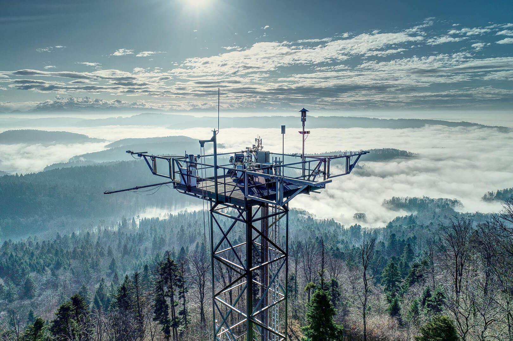

# CH-LAE Flux Product (PI dataset)

::: {.callout-note title="FP2026.1 released on 27 October 2026"}
The first release, **FP2026.1**, covers January 2016 to September 2026 and is available on
request. The second release, FP2026.2, adds the fluxes from 2004 and is in progress. See
[Dataset Versions](Dataset_Versions.md).
:::

produced by [Lukas Hörtnagl](https://gl.ethz.ch/people/person-detail.lukas.html)

Documentation and notebooks for the PI dataset of the **mixed forest station [CH-LAE (Laegeren)](https://www.swissfluxnet.ethz.ch/index.php/sites/site-info-ch-lae/)**. The site is part of [Swiss FluxNet](https://www.swissfluxnet.ethz.ch/), operated by the [Grassland Sciences Group, ETH Zurich](https://gl.ethz.ch/). Group leader: [Prof. Nina Buchmann](https://gl.ethz.ch/people/person-detail.nina.html).

The dataset holds ecosystem fluxes measured by eddy covariance (CO2, H2O and sensible heat) and meteorological data. FP2026.1 contains the fluxes of the enclosed-path LI-7200 gas analyser from January 2016 on. The fluxes of the open-path LI-7500, measured from 2004 to 2017, are being processed for FP2026.2.

- [Overview](Overview.md): what the dataset contains and how it was produced.
- [Variables](Variables.md): the main variables, their units and the column suffixes.
- [Meteorological data](Meteo_Data.md): one page per variable, with its columns, coverage, flags and known limitations, and an [interactive dashboard](Data_Dashboards.md) for each.
- [Post-processing chain](FPC.qmd): how the fluxes were quality-controlled, filtered and gap-filled.

Recent changes to the documentation are in the [commit history](https://github.com/holukas/dataset_ch-lae_flux_product/commits/main/), planned updates in the [Issues](https://github.com/holukas/dataset_ch-lae_flux_product/issues) of the repository.

{#fig-photo-ec2}

## Current dataset version

### **CH-LAE FP2026.1 (2016-2026.09) [current version]**

First release, 1 January 2016 to 30 September 2026. Fluxes of `NEE`, `LE`, `ET` and `H` from the
enclosed-path LI-7200, gap-filled, with the uncertainty of `NEE`, and all meteorological data of
the site.

release date: 27 October 2026

available on request from the Grassland Sciences group, ETH Zurich

For details and what is not yet included, see [Dataset Versions](Dataset_Versions.md).

## Next dataset version

### **CH-LAE FP2026.2 (2004-2026.09) [in progress]**

Extends the flux record back to 2004 with the fluxes of the open-path LI-7500. It re-includes
FP2026.1 in full and supersedes it.

## Acknowledgments

We acknowledge the scientific advice by Iris Feigenwinter, Yi Wang, Lukas Hörtnagl, Lutz Merbold, Werner Eugster and Nina Buchmann. 

The authors are grateful to Thomas Baur, Meier Philip, and Markus Staudinger for technical assistance and maintenance of instrumentation. 

Meteorological data were made available through MeteoSwiss, Federal Office of Meteorology and Climatology, Switzerland and the Swiss air quality monitoring network (NABEL). We thank the forester Philip Vock for enabling and supporting the studies at the Lägeren forest, Johannes Böhm, Roger Süess, Arnold Streule and Thomas Baur for maintaining the EC infrastructure, as well as Lydia Gentsch for continuing the soil respiration measurements at the Lägeren in 2008. 

### Funding

This work was funded by the ETH Zurich, Switzerland (ETH research grant TH-1006-02), and the Swiss Federal Office for Environment (BAFU Contract-No. 04.1140.PJ/I153-2413 and 06.0091.PZ/I153-2518). We acknowledge funding from the ETH Zürich project FEVER (ETH-27 19-1), and the SNF funded project EcoDrive (IZCOZ0_198094).